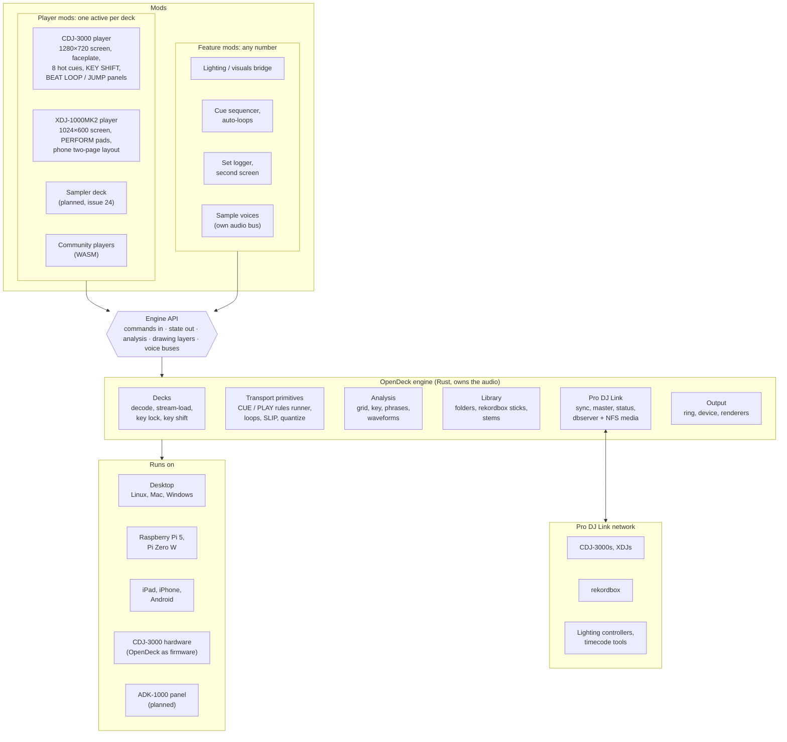
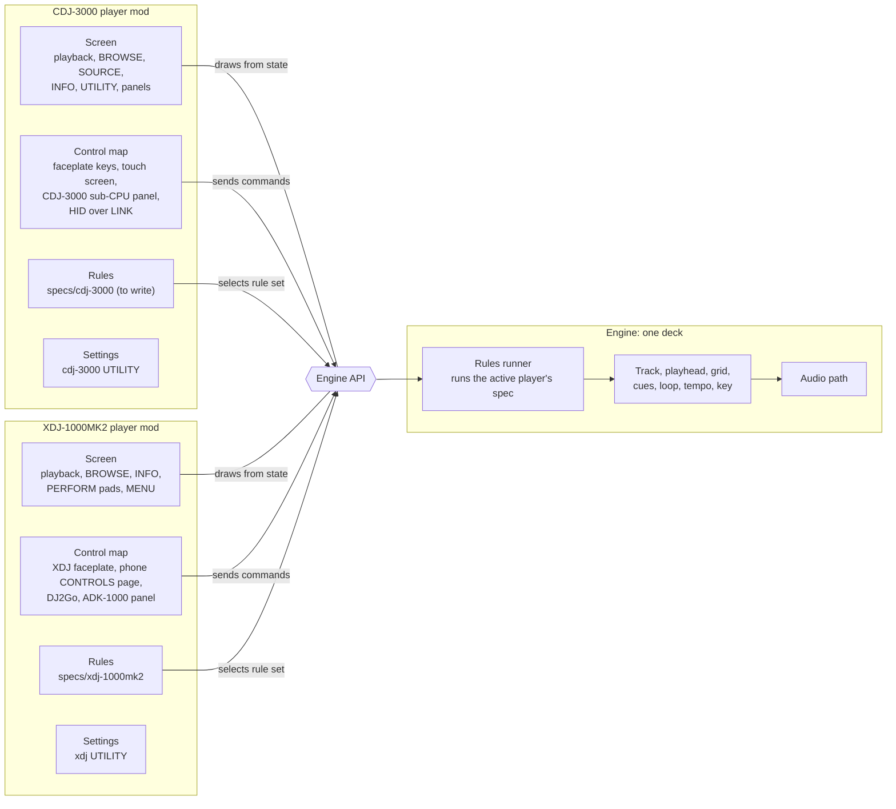
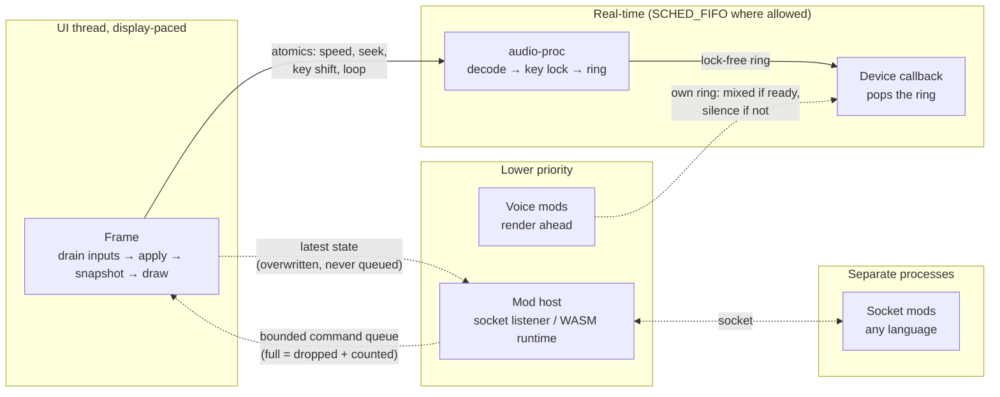
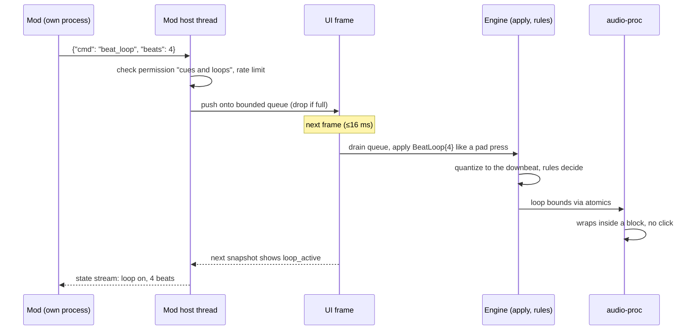
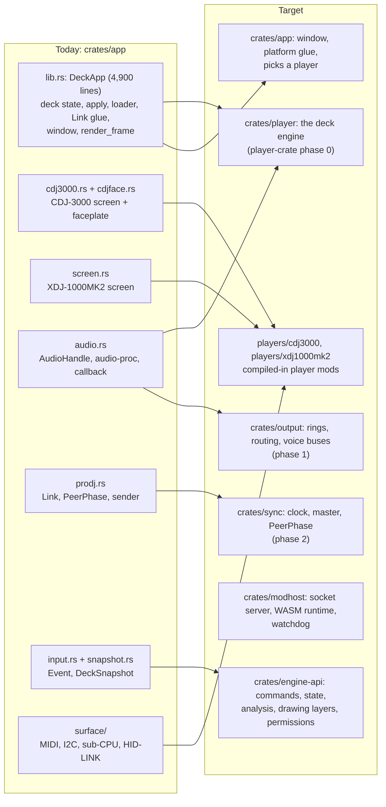
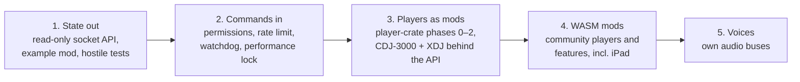

# Design: OpenDeck as an engine, players and features as mods

Status: **proposal, not decided** (2026-11-14). Nothing here is built.
Builds on [player-crate.md](player-crate.md) (lifting the deck engine out of
the app) and [transport-rules.md](transport-rules.md) (CUE / PLAY as a pure,
spec-checked state machine).

## The idea

OpenDeck started as a reproduction of one player, the XDJ-1000MK2, and grew a
second, the CDJ-3000. Both are the same engine underneath: the same decoder,
key lock, transport, loops, cues, analysis, library and Pro DJ Link. What
differs is the screen, the controls, and a handful of behaviour rules.

So turn it around. **OpenDeck is an engine. A player is a mod on top of it.**
- The CDJ-3000 screen and feature set is one player mod.
- The XDJ-1000MK2 is another.
- The sampler deck ([sampler-deck.md](sampler-deck.md)) would be a third.

A DJ, or a modder, can change a player or write a new one without touching,
or being able to break, the engine.

## Why now: the community is already modding CDJs

DJs are modding their CDJ firmware. OverCue, for example, adds stems
playback to a CDJ-3000 by injecting a library into Pioneer's player process.
It works, and people want it. But that kind of mod:

- patches a closed binary, so every firmware update can break it;
- runs inside the player's process, so a bug in the mod can stop the deck's
  audio or crash it mid-set;
- has no API: each modder re-discovers the same internals.

OpenDeck can offer what those modders are reaching for: a deck whose
"firmware" is open, with a stable, documented engine API. The player itself
is replaceable, and a mod can't take the audio down. OpenDeck already boots as
firmware on CDJ-3000 hardware in the emulator
([../hardware/cdj-3000-install.md](../hardware/cdj-3000-install.md)), so the
same engine and mods could run on a CDJ-3000 itself.

## The constraint: absolute performance

The core is Rust because performance comes first: zero underruns, a
playhead that never judders, CUE landing on the beat, and a Pi Zero W playing
cleanly on one core. Mods are only worth having if the engine stays exactly
that fast. That gives one rule, which everything below follows:

> **The engine's hot paths do not know mods exist.** The audio path never
> calls mod code, never waits on a mod, and never takes a lock a mod can
> hold. The UI frame never waits on mod code; it publishes state mods can
> read and drains a bounded queue of their requests, as it drains controller
> input.

## 1. The ecosystem

Where everything sits: the engine in the middle, players and features on
top, the devices it runs on below, and the Pro DJ Link network beside it.

What each layer owns:

| Layer | Owns | Written in | Can break the audio? |
|---|---|---|---|
| Engine | Everything with timing or audio in it: decode, key lock, transport primitives, loops, SLIP, quantize, the beat clock, analysis, library, Link, the output | Rust, in this repo | — (it *is* the audio) |
| Player mod | What makes a CDJ-3000 a CDJ-3000: screen, control map, behaviour rules (specs), its MENU / UTILITY settings | Rust compiled in (ours) or WASM (community) | No |
| Feature mod | One addition on top of a player: a panel, a mapping, a bridge, a tool, a voice | Any language over the socket, or WASM | No |

## 2. The CDJ-3000 and XDJ-1000MK2 as player variants

Both players share one engine and one deck. Switching player mid-set
(MENU → SCREEN today) loses nothing, because the track, playhead, grid,
cues and loop all live in the engine, not in the player.

What actually differs between the two, and so what a player mod has to
supply:

| | CDJ-3000 player | XDJ-1000MK2 player |
|---|---|---|
| Screen | 1280×720, panels under the waveform | 1024×600, PERFORM pads on screen |
| Hot cues | A–H on the faceplate | A–D per bank, E–H on bank 2 |
| Extra controls | KEY SHIFT, BEAT LOOP / BEAT JUMP panels, SOURCE, SEARCH keyboard | phone two-page layout |
| Hardware it drives | CDJ-3000 panel (sub-CPU SPI), CDJ-3000 over HID-LINK, iPad faceplate | XDJ faceplate, DJ2Go, ADK-1000 panel |
| Behaviour rules | to write as `specs/cdj-3000/` | `specs/xdj-1000mk2/` (exists) |
| Default on | desktop, Pi, iPad, Android tablet | phones |

Everything else (decoding, key lock, cues, loops, SLIP, analysis, browsing
rekordbox sticks, Pro DJ Link, serving music to other players) is the
engine, shared by both and by any future player.

## 3. Threads: who waits on whom

The performance rule as a picture. The solid arrows on the left are the
existing hot paths. Every arrow that touches a mod is a non-blocking queue:
a full queue drops, it never waits.

The cost to the engine:

| Situation | Extra work in the engine |
|---|---|
| No mods (the default) | one empty-queue check per frame |
| Mods watching | one copy of the snapshot (a few hundred bytes) per frame into a single slot |
| Mods sending commands | applying events at controller rates, through the same `apply` a key press uses |
| A voice mod playing | one add per sample per voice bus in the callback, or nothing if its ring is empty |

A first-party player compiled in (option A below) costs exactly what the
screens cost today: it is the same code, behind an API instead of inside
`DeckApp`.

## 4. A mod's request, step by step

A lighting-desk feature mod asks the deck to set a 4-beat loop on the next
downbeat. Nothing in the audio path waits for any of it.

## 5. Where mod code runs

The API is the same for every mod; how its code is hosted depends on whose
code it is.

| | A. Compiled-in Rust | B. Out of process (socket) | C. WebAssembly | Native libraries |
|---|---|---|---|---|
| For | our players (CDJ-3000, XDJ, sampler) and contributed ones | tools: lighting, visuals, logging, remote control, tests | community players and features on every device | — |
| Engine cost, no mods | 0 | ~0 | ~0 (+ a few MB of binary) | 0 |
| Speed of the mod | native | native, plus a local round trip (tens of µs) | near-native on desktop; interpreted (~10× slower) on iOS | native |
| A mod crashes | deck dies (code review is the guard) | mod dies | mod disabled | deck dies |
| A mod loops forever | deck hangs | its own core busy | stopped by its CPU budget | deck hangs |
| On the iPad itself | yes | no (LAN only; iOS can't run other programs) | yes | no |
| Can be a whole player | yes | no | yes | — |
| Verdict | yes | yes, first | yes, after the API settles | **no**: this is how CDJ mods work, and it's what lets them stop a show |

## 6. Mods that make sound

- **Voices** (samplers, one-shots, extra stems): the mod renders ahead into
  its own ring at lower priority. The callback adds that ring if samples are
  there and nothing if not. A late or dead mod is silence on its bus; the deck
  plays on.
- **Processing the deck's own audio** (effects, stem separation): the mod
  would have to sit inside the chain, which the rule keeps it out of. The safe
  form runs it in parallel and falls back to dry on any late block. That
  doubles the work, and the effect audibly drops out when a block is late.
  Stems in OpenDeck today (the OverCue reader, on-device HTDemucs) are engine
  features for exactly this reason.

**Proposal:** voices as mods; processing stays in the engine until a concrete
mod needs it.

## 7. Show safety

- **Watchdog:** each mod has a CPU and memory budget and an event-rate limit,
  well above any controller's. Over budget means disabled for the session,
  with its name on screen.
- **Performance lock:** no installing, updating or re-permissioning mods while
  a track plays.
- **Safe mode:** a start-up option, and a key held at boot, that starts the
  built-in CDJ-3000 player with every mod off.
- **Fallback player:** if a community player mod fails, the deck drops to the
  built-in CDJ-3000 player with the same track, position and cues. The engine
  holds all of that, so only the look changes.
- **Permissions, declared per mod:**
  - read-only (state, analysis, Link);
  - cues and loops;
  - transport;
  - tempo and key;
  - load tracks;
  - own panel;
  - own audio bus.

  A read-only mod cannot change what the deck plays.

## 8. Proving it: hostile-mod tests

Each guarantee becomes a test: play a track on the headless deck harness
(`deck_harness`, the real audio processor, no window or sound card) while a
deliberately broken mod runs:

| Hostile mod | Must hold |
|---|---|
| spins forever | zero underruns; disabled within its budget |
| allocates until killed | zero underruns; the deck's memory unaffected |
| crashes on its first state update | zero underruns; the others keep running |
| floods 10,000 commands a second | zero underruns; PLAY / CUE still answer; excess dropped and counted |
| connects and never reads | zero underruns; its state slot is overwritten, nothing queues |
| a voice that stops mid-bar | zero underruns; its bus goes silent, the deck plays on |
| a player that traps while drawing | the built-in player takes over, same playhead |

Zero underruns is checked with the existing counters
(`AudioStats::underrun_events`). The suite runs in CI. On the Pi Zero W it is
run by hand, since a mod there shares the audio's only core.

## 9. From today's code to the target

Today the two players are files inside the app crate, reaching straight into
`DeckApp`:

## 10. Milestones

1. **State out (days).** OpenDeck publishes its live state at frame rate on a
   local socket: playhead, beat and bar, BPM, key and key shift, cues, loop,
   master, sync. Track analysis comes on request. Off by default, local-only
   unless turned on. Ships with an example mod and the first hostile tests.
   Zero risk: mods can only watch. It needs no refactor, because the snapshot
   already exists every frame, and it fixes the API's state format for
   everything after.
2. **Commands in (days).** Mods send the events a controller sends, with
   permissions, a rate limit, the watchdog and the performance lock. Enough
   for control mods.
3. **Players as mods (weeks).** Player-crate phases 0–2, then the CDJ-3000
   and XDJ players move behind the API as compiled-in mods, with their rules
   as specs. No behaviour change, gated by `make perf`, the underrun
   counters, the CUE timing check and idle CPU before and after. This is a
   large mechanical refactor of the app crate; it needs a quiet window in the
   files other work touches.
4. **WASM mods.** Community players and features on every device, including
   the iPad. A mod is a file the DJ copies onto a stick.
5. **Voices.** Own audio buses, for a real mod that needs one.

Milestones 1–3 are worth doing even if no third-party mod ever ships: 1–2
are a remote-control and test API, and 3 is the player-crate plan.

## Open questions

- Is the first non-built-in player a community one, or ours (the sampler)?
- How much of the screen should a community player control? Engine-drawn
  waveforms with a mod-drawn frame is fast; fully mod-drawn screens need a
  GPU budget per frame.
- Wire format for the socket: something schema'd (FlatBuffers, Cap'n Proto)
  or JSON lines for approachability? Either is small at 60 Hz.
- Distribution: files on a stick (as CDJ mods are passed around today), a
  catalogue, or both? Signed?
- When OpenDeck runs on a CDJ-3000 itself, do mods install the same way?
