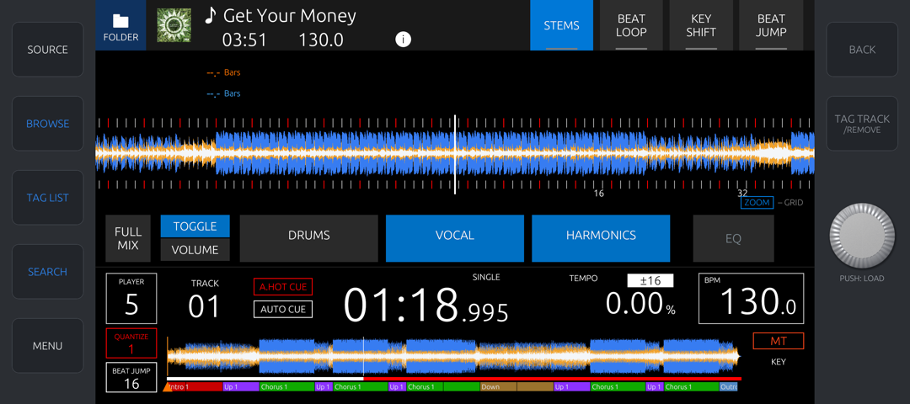
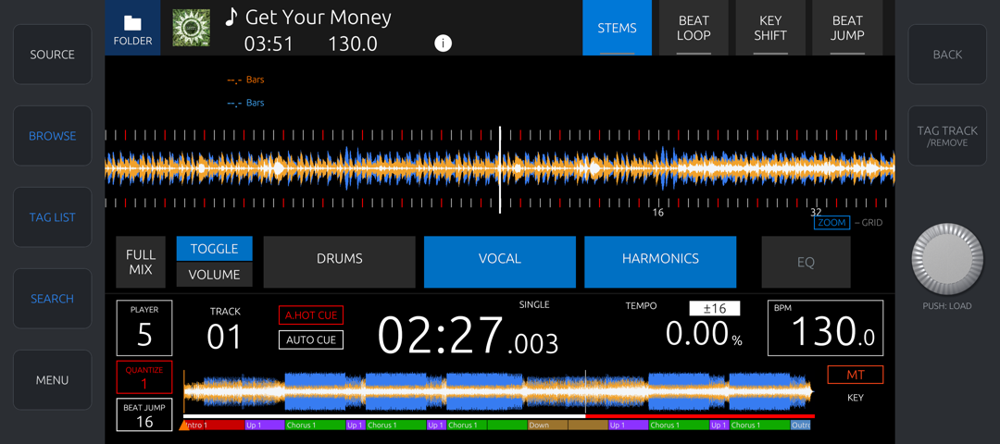

# OpenDeck as a stemd server

Status: **built and working 2026-11-21** (`crates/stemd`,
`crates/app/src/stemdsrv.rs`): an emulated CDJ-3000 running cdj3k-mods
v0.1.1 found OpenDeck over mDNS, sent it a track and played the stems
OpenDeck split (see "On the emulator").

## Why

Dan: "Other people are streaming to OverCue", then "maybe we support stemd
first".  OverCue players load stems only from players running OverCue, and
OverCue's own Live Stems is a private protocol (tested twice on the emulator,
`stems-overcue.md`).  The open route to a CDJ-3000 is
[cdj3k-mods](https://github.com/loyahdev/cdj3k-mods) (Apache-2.0): its
**Server Stems** sends the loaded track to a [stemd](https://github.com/nsaintot/stemd)
server on the network (MIT OR Apache-2.0) and plays the stems that come back.
stemd's HTTP contract is published (`docs/api.md`).  So OpenDeck answers it,
and a modded CDJ-3000 gets stems split by OpenDeck: the iPad's Core ML, a
desktop's HTDemucs.

## What the deck's client uses

From cdj3k-mods `package/deck/stemd_client/` (read 2026-11-21):

- **Discovery:** `avahi-browse -rtp _stemd._tcp`, or a typed `host[:port]`
  (port 8420 by default).
- **Health:** `GET /v1/health`; compatible when `sample_rate` is 44100,
  `channels` is 2, and the strings `"harmonics"` and `"vocals"` appear.  Its
  cache is keyed on `separation_id`, else `backend-model-preset`.
- **Job:** `POST /v1/jobs?sample_rate=44100&channels=2&format=f32le&output_format=flac`,
  plus `&output_sample_rate=96000&dsp_mode=1` when it knows its pool runs at
  96 kHz.  Body: the deck's own decode, f32le.  Reply `200`/`202` with `id`.
- **Poll:** `GET /v1/jobs/{id}` every interval: `stage` (`queued`,
  `analysing`, `separating`, `reconstructing`, `writing`, `done`, `failed`),
  `fraction`, `completed`; when done `sample_rate`, `frames`, and
  `stems[].gain`.
- **Fetch:** `GET /v1/jobs/{id}/stems/harmonics` and `/vocals`, written to
  tmpfs.  Drums are rebuilt on the deck as mix − harmonics − vocals.
- **Cancel:** `DELETE /v1/jobs/{id}`.
- HTTP/1.1, `Connection: close`, exact `Content-Length` both ways.

## What we serve

All of the above, plus: `pcm16`/`s16le`, `pcm32`/`f32le`, `wav`, `flac`;
output at 24, 44.1, 48 or 96 kHz; `parts` drawn from harmonics, vocals and
drums (leaving one out, which is the derived part), `include_derived`; a
cache (the same audio and parameters again is a `200` with the finished job);
the last six finished jobs keep their stems (older ones answer `410`, as stemd
does).  Not served: `bass` / `other` as parts (our split folds them into
harmonics), `mp3`.

**dsp mode 1** is stemd's copy of the CDJ-3000's 44.1 → 96 kHz converter: a
polyphase FIR (L = 320, M = 147, 18,880 taps) that stemd's author measured
by driving the converter with impulses.  The deck subtracts the stems from a
mix *it* resampled, so the rebuilt drums only cancel if the stems went
through the same filter.  Ported from stemd under MIT with its coefficient
table and reference vectors (`crates/stemd/data/`, licence alongside); our
port nulls against stemd's captured reference below −120 dB.  Nothing was
taken from Pioneer's software.

**FLAC** stems are verbatim (valid FLAC, no compression, fixed 4096-frame
blocks): 69 MB for a 3-minute stem at 96 kHz where stemd's run 20–30 MB.
The deck spools them to RAM and decodes them once; a real encoder (fixed
predictor + Rice) would cut that about 2.5x and is the obvious next step.

**The model** is the device's own (`livestems::model_split`: the native Rust
HTDemucs, ONNX, or Core ML), at 44.1 kHz.  The server's splitter waits while
the device's deck is splitting and cancels a job under way when the deck
starts one, as live stems do.  On whenever live stems are
(`livestems::enabled`: a model, not a Pi by default); `OPENDECK_STEMD=0`
turns it off.

## Sessions (stems at the playhead first)

stemd's own sessions API (`docs/api.md`, "Sessions"): not an extension, and
not ours.  cdj3k-mods v0.1.1 doesn't use it (whole-track jobs only, so its
stems come after the whole split); OpenDeck's client does.  Served
(`crates/stemd/src/session.rs`): open (`POST /v1/sessions?frames=…`), upload
(`PUT …/pcm?offset=`, any order), window (`PUT …/window`, the needle), view
(`arrived`, `ready`, `state`), ready ranges (`GET …/stems/{name}?from=&to=`
with `x-stemd-from` / `-frames` / `-gain` / `-clipped`), `DELETE`; `pcm32`
or `pcm16` at 44.1 kHz; the derived part with `include_derived`.  Not
served: stored `pieces`, sharing a track between sessions, early `mean` /
`std` (our model normalises by the whole track, so the split starts once
the upload is complete).  Behind it, `Splitter::split_live`: the app runs
the device split with the session's needle as its playhead (no look-ahead)
and reports each bank page as it is whole.

## OpenDeck as a client

`crates/app/src/stemdclient.rs`.  When a track's STEMS panel opens and it
has no prepared stems: live stems from the linked OpenDeck it came from,
else a **stemd server** (`OPENDECK_STEMD_SERVER=host[:port]`, else the first
`_stemd._tcp` over mDNS that isn't this device; `OPENDECK_STEMD_CLIENT=0`
off), else a split on this device.  The client opens a session at 44.1 kHz,
sets the window to the start of the deck step the playhead is in (less the
few thousand frames a step reads before itself), uploads the track in 10 s
pieces from the playhead, then fills its bank a step at a time from the
playhead as ranges become ready: harmonics and vocals over the wire, drums
= mix − both (exact), all three converted to the deck's rate.  A jump to
somewhere not split moves the window.  It speaks plain stemd, so it also
works against stemd itself (e.g. with CUDA on the RTX 4070 desktop).

Fill steps are now whole bank pages (`stems::step_frames`, ~4 s): a step
that began mid-page left that page waiting for the step before it, so the
stems at a mid-track playhead only counted as ready once the split had
wrapped round (67 s instead of 7 s; prepared and live banks had the same
edge).

## Measured

`real_model_stemd_job_over_http` (desktop, `separate-native`, a 3:00 MP3,
f32le up, FLAC at 96 kHz via mode 1 back): split and encoded in 65 s (2.8x
real time), model residual −31 dB (lands on the rebuilt drums, as with
stemd's Fast preset), stem gains 0.90 (peaks past full scale scaled to fit).

## On the emulator (2026-11-21)

cdj3k-emu slot 2 (CDJ-3000, firmware 3.22) booted with nsaintot's
`cdj3k-mods-v0.1.1-modloader.tgz` (digest checked against GitHub's record of
the release asset) as a launch-only mod, on the private bridge `djlink0`.
OpenDeck on the host: release build, `separate-native`, the stemd server on
port 8420.

1. The deck's avahi saw the advert: `OpenDeck opendeck._stemd._tcp`,
   `169.254.77.1:8420`, TXT `v=1 path=/v1 model=…`.
2. UTILITY showed `Ver.3.22-m`; MOD SETTINGS → ENABLE STEMS → ON (server
   location AUTO).
3. Loading "Heard It Like This" (3:40) from the deck's own USB, the deck
   uploaded it: job `6171ceb4c313-1`, 9,723,756 frames at 44.1 kHz.
   OpenDeck split it in 78.9 s.
4. The STEMS row came up live (DRUMS, HARMONICS, VOCALS in colour, not
   grey), and the spool in `/dev/shm` was empty again: the mod had taken
   the stems in.
5. Holding DRUMS muted it: the waveform lost its drum transients, the label
   read MUTED and the STEMS button showed its "not as it came in" dot.

The audio itself wasn't listened to (the emulator's output goes nowhere
here); the waveform following the faders is drawn from the stems' own
levels, which is the evidence.

Sessions, OpenDeck → OpenDeck (`real_model_stemd_session`, the same desktop
as both server and client over loopback, a 48 kHz deck playing from 60 s
into a 3:00 track): stems at the playhead after **6.7 s** (the whole upload,
then one model chunk on the CPU), the whole track after 67 s.

Two OpenDeck instances on this desktop (2026-11-21): **A** with the model,
its stemd server on 8420, no media server; **B** with no model,
`OPENDECK_STEMD_SERVER=127.0.0.1:8420`, the CDJ-3000 screen with the STEMS
panel open, "Get Your Money" (3:51) needled to 60 s and playing, drums
muted.  B opened a session, uploaded the track (0.09 s over loopback), and
had **the first 4 s at its playhead playable 2.4 s later**; A split the
whole track in 87 s (CPU), B's bank filling from the playhead meanwhile.

## Tests

`crates/stemd/src/tests.rs` drives the server exactly as the deck's
`http.c` does: health passes the deck's compatibility check; a whole job
(f32le up, pcm16 back) rebuilds drums from the mix to 1e-4; the same audio
twice is a cache hit with no second run; DELETE stops a running job;
unknown jobs are 404 and unoffered formats / parts / dsp modes 400; mode 1
stems cancel against a mix converted with the same filter.  `mode1.rs`
holds stemd's reference test.  `stemdsrv.rs`: the app's splitter returns
the bank's levels and gives way to the deck.

## Next

- Try it on a real CDJ-3000 running cdj3k-mods, and listen.
- A real FLAC encoder.
- Upload only the stretch around the playhead before asking for the window (stemd's `mean` / `std`): the first stems would no longer wait for the whole upload.
