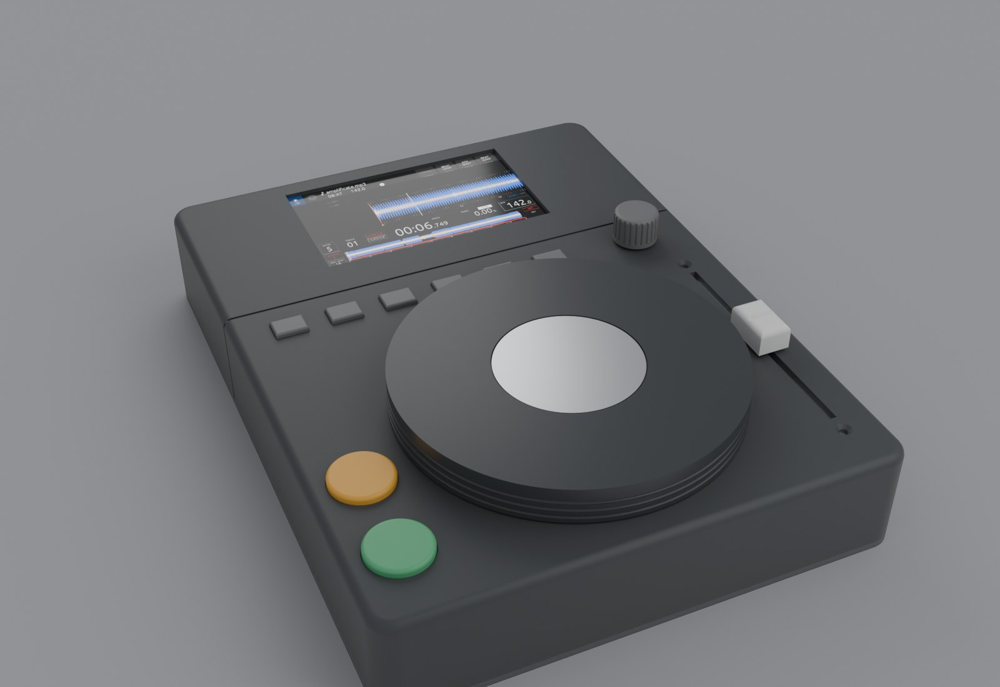
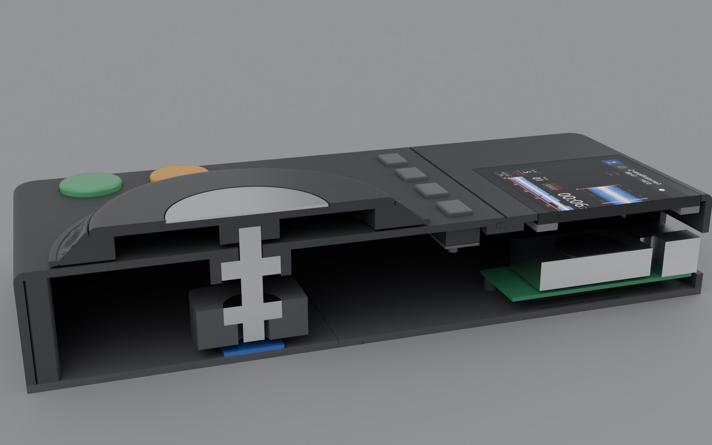
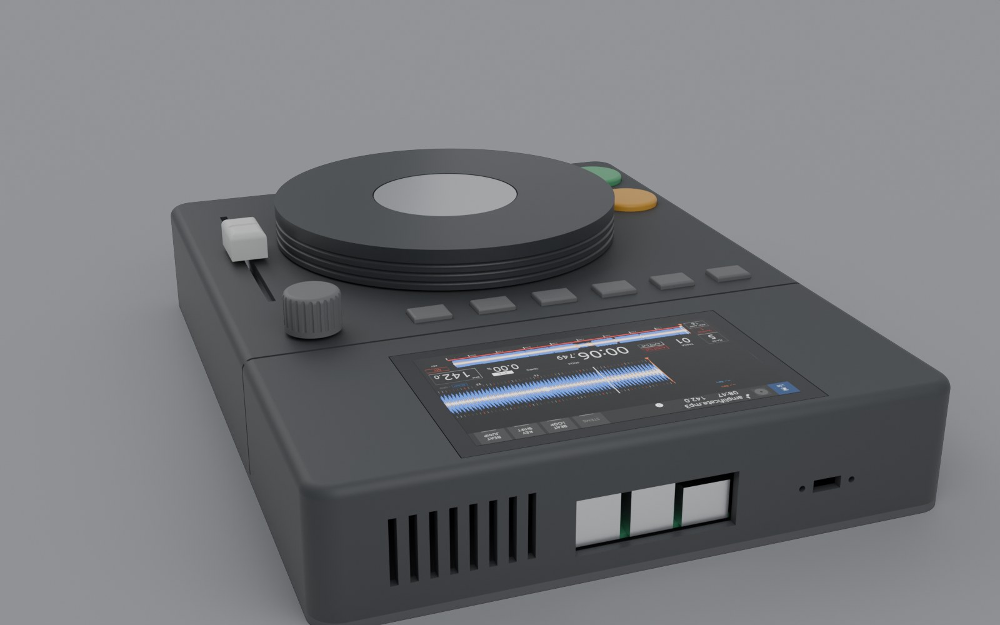
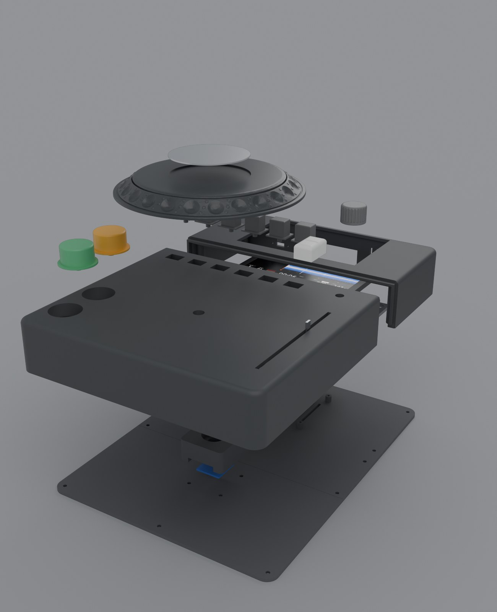
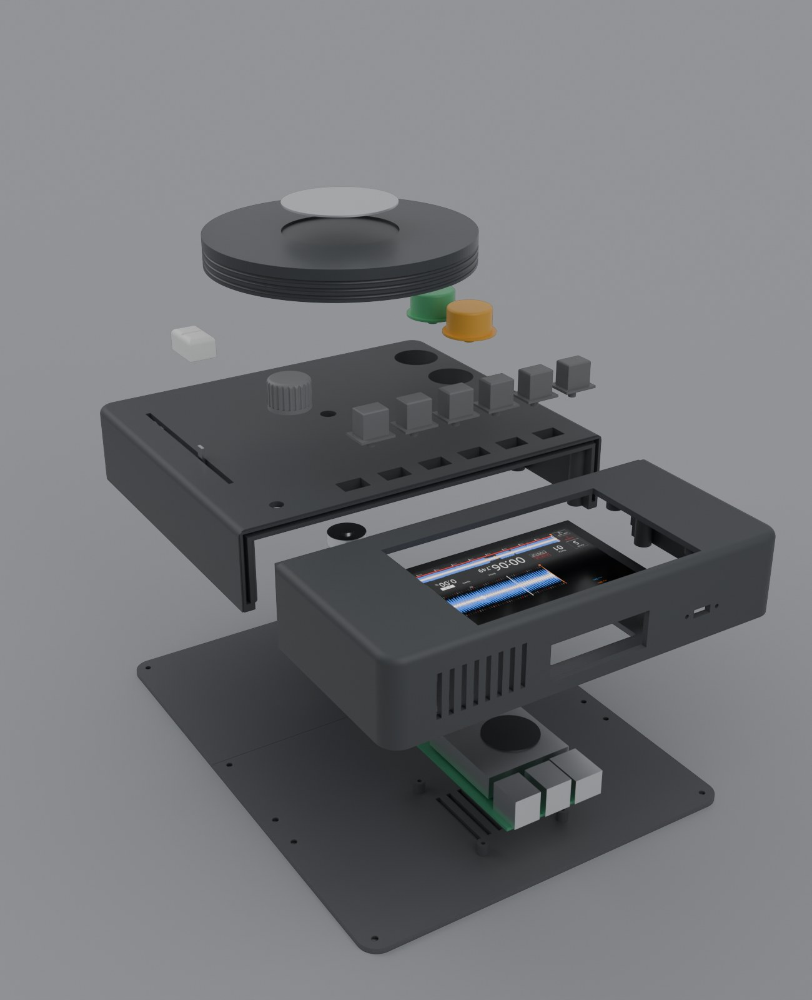
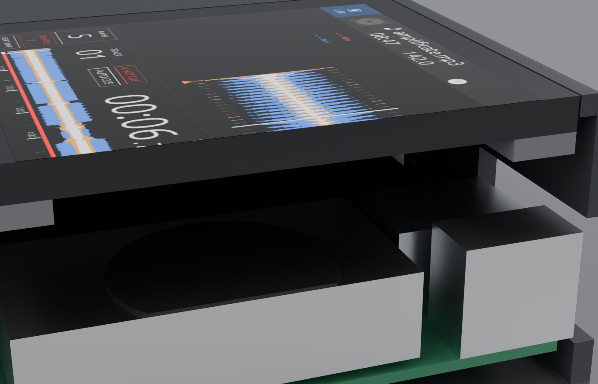
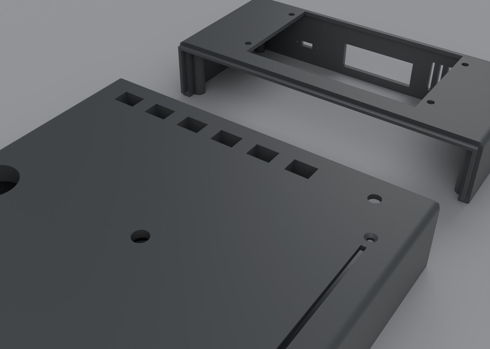
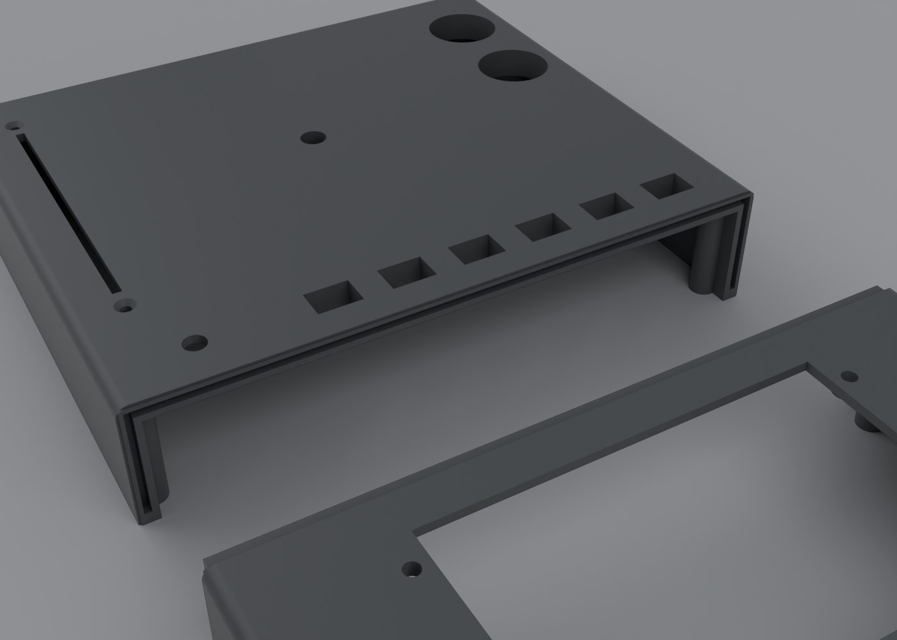

# deck5 — the 5" flagship deck, first iteration

A small, quick-to-print OpenDeck: a Raspberry Pi 5 with its Active Cooler,
a 5" 800 × 480 DSI touch display (Hosyond), a 140 mm Pioneer-style jog on two 608 bearings with a
contactless AS5600 encoder, a 100 mm pitch fader, CUE / PLAY, six keys and
a browse encoder.  214 × 280 × 46 mm (59.4 mm to the top of the jog).

Small on purpose: every part fits a 220 × 220 bed, so a design change is a
print overnight, not a weekend.  The full-size deck,
[deck7](../deck7/README.md) (200 mm jog, 7" display), grows out of the same
code: it runs this folder's `jog.py` and `caps.py` with its own `params.py`.



| | |
|---|---|
|  |  |
| Cut through the jog's axis: platter, shaft on two 608s, the tower and the AS5600 under the shaft's magnet; the Pi 5 and cooler under the screen. | USB / Ethernet straight out of the Pi, a panel USB-C for power, vents beside the cooler. |
|  |  |

## The screen mount



The display drops into an opening in the top plate from above, glass
flush with the top surface, and rests on `screen_frame` under the plate.
Four M2.5 screws come up through the frame into the threaded inserts on
the display's back; the frame's four ears screw to bosses under the top
plate.  The frame is a separate flat part because a ledge built into the
shell would be a 7 mm unsupported overhang when the shell prints face down.
To take the display out, undo the four M2.5 and push it up through the
frame's middle.

**Nothing screws in from the top.**  The display sits only 4.9 mm below the
surface, too shallow for an insert above its frame, so the frame's bosses
hang down through clearance holes in its ears and an M3 + washer from below
pulls the frame up; the fader hangs the same way on its bracket.  Every
insert bore is blind, with at least 1.5 mm (`SKIN`) of plastic left over
it.  `make deck5` fires a ray grid down at the top pieces and fails on any
opening that is not on the list (screen, fader slot, caps, keys, encoder,
jog shaft), so a bore that breaks through cannot slip by again.

The display board also has a 3.3 V header marked "fan only": it is for a
small fan on a Pi mounted on the display's back, the way these kits ship.
Here the Pi sits on the base with its own Active Cooler on the Pi's fan
connector, so the header is unused.  It could run a small 3.3 V exhaust
fan behind the back vents if the cooler alone runs hot in the case.

## The two-piece top




The top shell is designed and modelled as one piece, then split across the
depth at `Y_SEAM` (184 mm), on the line between the control panel and the
screen panel, where a seam reads as a design line, not a repair.

- **Band.** For 8 mm each side of the seam, the shell is thickened inward
  to 6.5 mm (top and both walls), so the joint has meat to cut into.
- **Tongue and groove.** The back piece carries a U-shaped tongue (2 mm
  thick, 4 mm long) running across the top and down both walls; the front
  piece has the groove (0.15 mm clearance per side).  It aligns the two
  surfaces flush, stops them racking, and gives CA glue about 8 cm² of
  face to grip.
- **Reveal.** A 1.2 × 0.8 mm channel runs round the outside on the seam,
  so whatever the print does at the joint, the eye reads a deliberate line.
- **The base clamps it.** The base is split too, but at y = 120, so its back
  half spans the top seam; four bosses 10 mm either side of the seam take
  its screws.  Screwed down, the base alone holds the top together: glue
  is optional.  Try it dry first.
- **The base halves** join with a half-lap (each 1.5 mm thick across 10 mm)
  with two screws through the lap.

## Parts

### Print (`print/`, already turned to their print orientation)

| File | Qty | Notes |
|---|---|---|
| `top_front.stl` | 1 | 214 × 184. Top face on the bed (smooth / textured PEI picks the finish). No supports. |
| `top_back.stl` | 1 | 214 × 100. Same. The Pi port window's top is a 54 mm bridge. |
| `base_front.stl`, `base_back.stl` | 1 each | Flat. Countersinks are on the bed side (cones, no supports). |
| `jog_platter.stl` | 1 | Top face down (the flat top on the bed). 140 mm. |
| `jog_tower.stl` | 1 | Bearing seat up; the sensor slot bridges 25 mm. |
| `jog_shaft.stl` | 1 | Optional, to test before the steel rod is cut: 45.4 mm, the magnet pocket (6.2 × 2.7) up, no supports. 7.9 mm across so it slides into the 608s; a flat at the platter end for the grub screw. PETG or PLA at 100 % infill. |
| `cap_play_cue.stl` | 2 | One green, one orange (or paint). |
| `cap_key.stl` | 6 | |
| `knob_fader.stl`, `knob_encoder.stl` | 1 each | |
| `screen_frame.stl` | 1 | The display sits on it. Flat. |
| `fader_bracket.stl` | 1 | The fader hangs under it. Top face on the bed. |

PLA or PETG, 0.2 mm layers, 4 walls; 15–20 % infill is plenty.

### Buy

| Part | Qty | Notes |
|---|---|---|
| Raspberry Pi 5 (4 GB+) + Active Cooler | 1 | |
| Hosyond 5" DSI touch display, 800 × 480 | 1 | ⚠ check the outline, thickness and insert pitch before printing (below) |
| 100 mm travel slide pot (Alps RS60 / Bourns PTA, linear B) | 1 | ⚠ mounting-hole pitch |
| AS5600 magnetic encoder board (23 × 23) + 6 × 2.5 mm diametric magnet | 1 | |
| 608-2RS bearings | 2 | |
| 8 mm rod, 45.4 mm (or an M8 bolt's plain shank) + 2 shaft collars | 1 | cut to 45.4 mm: magnet end 0.5 mm over the sensor slot, top 2 mm under the platter face |
| EC11 encoder, 6 mm D-shaft | 1 | |
| 12 mm tact switches | 8 | Their board is the next step (below) |
| M3 heat-set inserts (4.6 × 5.7) | 21 | 11 base bosses, 4 screen-frame bosses, 2 fader bosses, 4 tower |
| M3 × 8 countersunk | 15 | base + tower |
| M3 × 10 socket + washer | 6 | screen frame (4) and fader bracket (2) up into their bosses |
| M2.5 × 6 | 4 | up through the frame into the display's inserts |
| M3 × 4 countersunk | 2 | fader to its bracket (heads flush in the bracket's top) |
| M2.5 × 6 | 4 | Pi into the base standoffs |
| M3 grub screw | 1 | platter onto the shaft |
| Panel-mount USB-C (to the Pi's USB-C) | 1 | |
| 10 mm rubber feet | 4 | |

### Assembly order

1. Heat-set inserts into all the shell bosses (11 base, 4 screen) and the tower (4).
2. Dry-fit the two top pieces; glue now if you want (thin CA in the groove).
3. Upper 608 into the jog boss under the top plate.  Fader onto its
   bracket (two countersunk M3 down into its end plates), lever up through
   the slot, the bracket's ears over their bosses, M3 + washer from below.
4. Caps into their holes from below (the flange keeps them in).
5. Screen frame onto its four bosses under the top plate (M3), the DSI
   cable through its middle; the display drops into its opening from the
   top, onto the frame, and four M2.5 come up through the frame into its
   inserts.
6. Pi onto the base's back half (M2.5), cooler on.  AS5600 into the tower
   slot; tower onto the front base half.
7. Shaft: magnet glued in its bottom end, collar, lower 608 (in the tower),
   collar.  Base halves together, lowered onto the top; shaft up through the
   upper bearing.  Screw the base on.
8. Platter onto the shaft, grub screw.

## ⚠ Measure before you print

Every ⚠ VERIFY in `params.py` is a datasheet number or a guess:

- **Display outline, thickness, insert pitch** (`SCR_OUT`, `SCR_T`,
  `SCR_HOLES`): no Hosyond drawing was found, so these are the numbers
  the common 5" DSI boards share (120.7 × 75.8 × 4.9, M2.5 at 113 × 68).
  The opening is cut from the outline, the frame's height from the
  thickness (glass flush with the top), its holes from the pitch.  Also
  check where the DSI connector sits: the frame's ring is 9 mm wide.
- **Fader body, mounting pitch, lever** (`FADER_BODY`, `FADER_PITCH`,
  `FADER_LEVER`).
- **Active Cooler height** (`PI_COOLER_H`): the gap to the display above
  it is about 7 mm.

## The platter

The platter's shape comes from a real Pioneer platter: a Meshy mesh made
from a photo, its dome cut flat in Blender (`hardware/cad/jog.stl`,
`jog.blend`), with the finger dimples on the shoulder and the band round
the base.  `python3 jog.py --ref` normalises it once into
`assets/platter_ref.stl`: its two shells welded, simplified to 0.03 mm, 1
unit across.  `jog.py` scales that to `JOG_D` and cuts the working parts into
it with mesh booleans (manifold3d): the hollow under the flat top, the hub
with the 8 mm shaft bore and grub screw, and the label recess.  The dimpled
shoulder stays solid, which adds inertia.  `JOG_H` follows the shape (12.4 mm
at 140 mm), and `jog.py` fails if the two disagree.  The full-size deck only
changes `JOG_D` (about 200 mm).

## Not done yet

- **The switch board.**  CUE / PLAY and the keys have guide sleeves and
  plunger stems, but nothing for their switches to sit on yet.  That is a
  small PCB (or perfboard) on bosses under each group, wired to an RP2350
  or the Pi's GPIO.  Bosses get added once its outline is chosen.
- **Jog touch.**  No touch sensing on the platter (the XDJ's is a top-plate
  switch; capacitive would be a copper disc under the label).
- **Audio out.**  The Pi has none: a USB audio interface on the Pi's
  USB-A for now.  An I2S DAC HAT would need the stack height checked.
- **Screen tilt.**  The screen panel is flat; a few degrees of tilt
  towards the DJ would read better.

## Rebuild

```sh
make deck5                         # check every part, export print/ (fails on a clash)
hardware/cad/deck5/render.sh       # assembly GLBs + renders/ (Blender, GPU)
```

- `params.py`: every dimension, one place.
- `top_shell.py`, `base.py`, `jog.py`, `caps.py`: the printed parts
  (the platter is a mesh, not a build123d solid; needs `manifold3d`).
- `assembly.py`: the printed parts plus stand-ins for the bought ones,
  exported as `build/deck5.glb`, `_cutaway`, `_exploded` and `_seam`.
  Open any of them in a glTF viewer (Blender, three.js, VS Code).
- `make_print.py`: the check, which every change must pass. Every part
  must be watertight, a single body and fit the bed, no two parts of the
  assembly may overlap, and the top surface may have no opening that is
  not on the list.
- `assets/screen.png`: the screen texture, a real OpenDeck frame (the
  bare CDJ-3000 screen at 800 × 480 through the fullscreen fill path).
