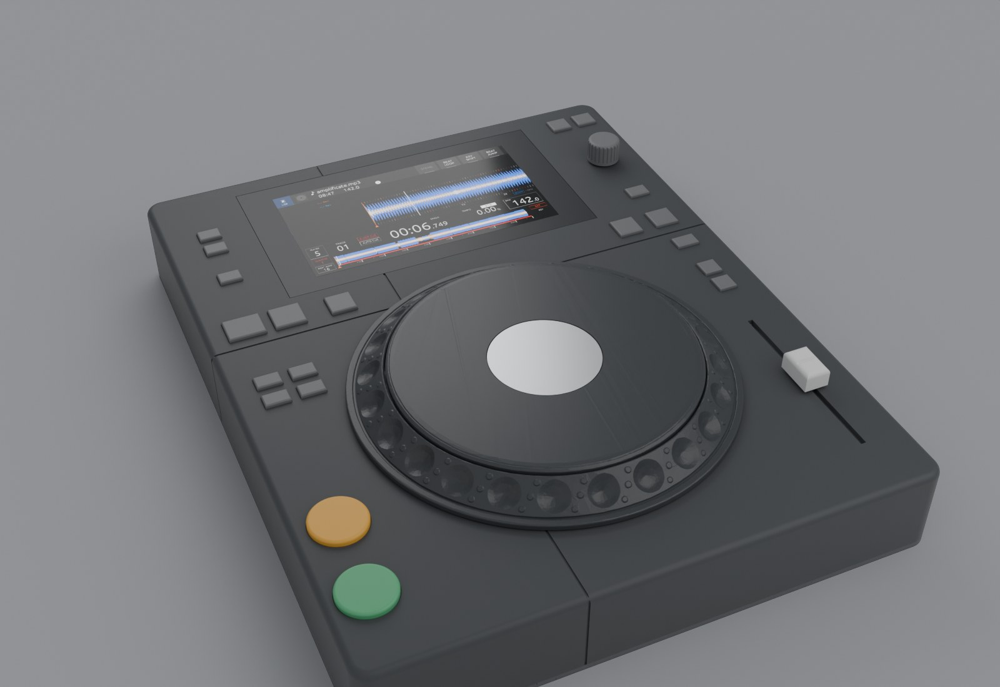
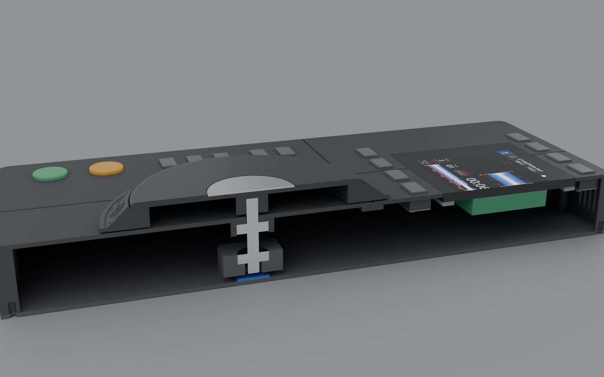
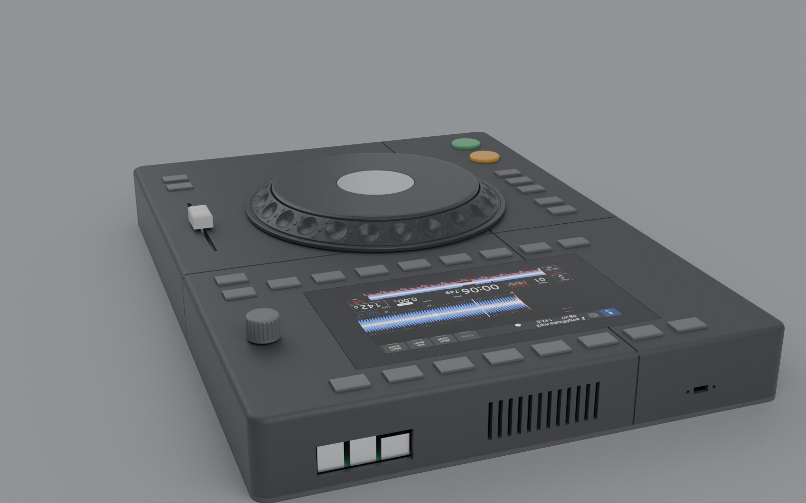
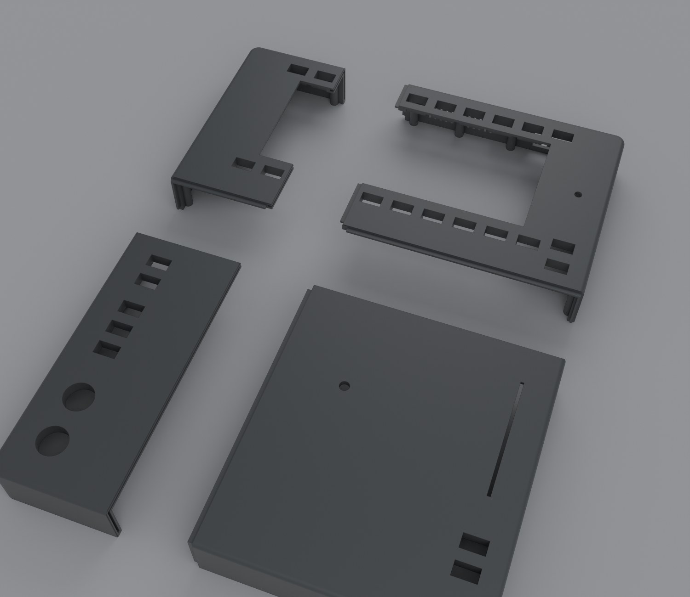

# deck7 — the full-size deck, first iteration

The full-size OpenDeck (ADK-1000): an **XDJ-1000MK2-sized** body (305.7 ×
387.5 × 50 mm, 69 mm to the top of the jog) around a **206 mm jog**, the
official **Raspberry Pi 7" Touch Display** (800 × 480, the panel the test Pi
runs, `vc4-kms-dsi-7inch`) and a Raspberry Pi 5 with its Active Cooler.
Every part fits a **256 × 256 bed** (Bambu X1 / P1 / A1).

It sits beside [deck5](../deck5/README.md) (the 5" deck) and is built the
same way, from the same code where it can be.

| | |
|---|---|
|  |  |
| From above. | Cut through the jog's axis: platter, shaft on two 608s, the tower and the AS5600 under the shaft's magnet; the display, its adapter board and the Pi under it. |
|  |  |
|  |  |
| The four top pieces pulled apart. | The display on its frame. |

## The face comes from layout.toml

The face is read from [`hardware/panel/layout.toml`](../../panel/layout.toml),
the XDJ-1000MK2 face measured off photos.  Each control there has a
`status`: `photo` (good to a few mm) or `guess`.  The panel PCB generator
reads the same file, so the plastic and a future panel board agree.  These
come from it:

- the face size (the published width; the depth from the photo's aspect,
  387.5, against a published 378.8: verify)
- the jog's centre and size (206 mm)
- the fader
- PLAY and CUE
- every key and its cap size
- where the display sits (the official 7" is centred on the XDJ panel's
  active area)

Moved from layout.toml, each with its reason in `params.py` (`OVERRIDES`):

| Control | Why |
|---|---|
| TIME MODE, AUTO CUE, SHORTCUT, USB STOP, BACK, TAG TRACK, the browse encoder | The official 7" display's glass is 193 mm wide, wider than the XDJ's own panel; they sat on it or on the frame's ear. |
| SYNC, MASTER | Guesses that fell under the 206 mm platter's rim; now in the right-hand column above VINYL. |
| MASTER TEMPO, TEMPO RANGE | MASTER TEMPO touched the fader bracket; TEMPO RANGE (a guess) moved with it. |
| TRACK SEARCH ▶▶, SEARCH ▶▶ | Guesses 18 mm from their pairs; the caps' flanges need 18.5. |
| PLAY, CUE | 30 mm caps, not 35: a 35 mm PLAY would cut into the edge fillet. |

The jog's top-plate touch switch (`jog_touch`) is not built yet.  If a
caliper pass on a real XDJ changes layout.toml, `make deck7` picks it up and
re-checks every fit.

## What is shared with deck5, and what is not

`params.py` here is the single source of truth for this deck.  deck5's
`jog.py` (platter, tower, shaft) and `caps.py` (PLAY / CUE caps, key caps,
knobs, the screen frame, the fader bracket) are **used unchanged**: they read
their dimensions with `from params import *`, and run from here that is this
folder's `params.py` (it puts deck5 on the import path after deck7).

- The 206 mm platter is deck5's Pioneer reference shape scaled up (`JOG_D`,
  with `JOG_H` = 18.25 mm to match).
- `keycap.py` calls deck5's key cap at each key's own size.
- A fix to either deck5 module reaches both decks.
- `render.sh` uses deck5's `render_blender.py` and the screen image in
  deck5's `assets/`.

New here: `top_shell.py` and `base.py` (a 2 × 2 split, below), and
`assembly.py` and `make_print.py` (adapted from deck5's for eight shell
pieces and the per-size keys).

## The four-piece top

The top is too big for one seam on a 256 mm bed, so it splits on a 2 × 2
grid:

- **`Y_SEAM`** runs across the depth, between the loop row and the search
  keys (face y 158).
- **`X_SEAM`** runs along the depth, at x 110, between RELOOP and the jog's
  bearing boss.

They cross under the platter and miss every key hole and boss.  Each seam
has deck5's joint: a 6.5 mm band each side, a tongue in a groove, and a
reveal line outside.

- The tongue is on the **back** pieces for Y_SEAM and on the **right**
  pieces for X_SEAM.
- The tongues stop 5 mm short of the cross so they never meet.
- They are trimmed to where the shell has material, because X_SEAM crosses
  the screen opening.

The base splits on its own grid (x 90, y 200) with half-laps, so its pieces
bridge the top's seams.  Where the two laps cross, front-left keeps the
lower half and back-right the upper.  Base screws sit 10 mm either side of
each top seam on the walls, plus one column at the base laps' cross (under
the platter), so the base alone holds the top together.  Glue (thin CA in
the grooves) is optional; try it dry first.

## The jog and the fader (`top_fr`)

Changed after the first prints: only `top_fr.stl` differs, and every other
part is as printed.

- **Both 608s are in the top.**  The jog boss under the top plate carries
  the two bearings 25 mm apart, as on the freedj-esp mini deck.  The upper
  one drops in from above into a seat open to the top surface (the platter
  covers it) and stands 0.4 mm proud.  The lower one presses in from below.
  Each stops on a ledge (19 mm bore between them, so the ledges only touch
  the outer races).  An M8 washer (1.6 mm) on the upper inner race carries
  the platter's hub, which keeps the platter at its old height.  One shaft
  collar under the lower inner race stops it lifting.  The printed shaft and
  the 55.2 mm rod are unchanged.  **The tower (`jog_tower`) is no longer
  used.**
- **The AS5600 board hangs from the top.**  It sits in a cage under the
  boss: four corner posts locate it and stop it 0.1 mm over its corners,
  and two spring fingers snap under its edges.  Push it in from below, chip
  up.  The chip ends 1.1 mm under the magnet, and the board 1 mm over the
  base.  The cage stays outside the lower bearing's path, so the bearing
  still goes in past it.  The two open sides give the collar's grub screw
  and the wires a way out.
- **The fader mounts from the front.**  Two M3 × 6 countersunk screws go
  down through the top into the fader's end plates (M3, 120 mm centres),
  and the fader's top sits straight against the underside of the plate.
  That is 2.5 mm higher than on the bracket: the lever now goes 7 mm into
  the printed knob's 8 mm socket (it was 4.5), and the knob sits at the
  same height.  **`fader_bracket` is no longer used.**

Assembly:

1. Top face down: press the lower 608 into the boss from below.
2. Top face up: drop the upper 608 into its seat and put the M8 washer on
   it.  Then push the shaft, magnet end first, down through both bearings.
3. Set the platter on the shaft, resting on the washer, and tighten its
   grub screw.
4. Top face down: slide the collar up the shaft to the lower bearing and
   tighten it through the cage's open side.  Then snap the AS5600 in, chip
   up, with its wires out the open side.
5. Fader: hold it up against the underside and drive the two countersunk
   M3 down from the face.

The renders in `renders/` predate this change.

## Parts

### Print (`print/`, already turned to their print orientation)

| File | Qty | Notes |
|---|---|---|
| `top_fl.stl`, `top_fr.stl`, `top_bl.stl`, `top_br.stl` | 1 each | Up to 199.7 × 229.5. Top face on the bed, no supports. |
| `base_fl.stl`, `base_fr.stl`, `base_bl.stl`, `base_br.stl` | 1 each | Up to 220.5 × 204.8. Flat; countersinks on the bed side. |
| `jog_platter.stl` | 1 | 206 × 18.2. Top face down. |
| `jog_shaft.stl` | 1 | Optional printed test shaft, 55.2 long. |
| `cap_play_cue.stl` | 2 | 30 mm. One green, one orange. |
| `cap_key_<w>x<h>.stl` | 18 in all | 21×17 (1), 18×17 (1), 15×15 (3), 13×12 (2), 14×9 (5), 11×11 (2), 13×9 (4). |
| `knob_fader.stl`, `knob_encoder.stl` | 1 each | |
| `screen_frame.stl` | 1 | 224 × 110.8. The display sits on it. |

PLA or PETG, 0.2 mm layers, 4 walls, 15–20 % infill.

### Buy

As deck5's list (same bearings, sensor, fader, encoder), except:

| Part | Qty | Notes |
|---|---|---|
| Raspberry Pi Touch Display (v1), 7", 800 × 480 | 1 | ⚠ caliper before printing (below) |
| 8 mm rod, 55.2 mm + 1 shaft collar (18 OD × 9 or smaller ⚠) | 1 | |
| M8 washer, DIN 125 (8.4 × 16 × 1.6) | 1 | between the platter's hub and the upper bearing |
| 12 mm tact switches | 20 | 18 keys + CUE + PLAY; their boards are not designed yet |
| M3 heat-set inserts (4.6 × 5.7) | 23 | 19 base bosses, 4 screen-frame bosses |
| M3 × 8 countersunk | 19 | base |
| M3 × 6 countersunk | 2 | fader, from the face into its end plates |
| M3 × 10 socket + washer | 4 | screen frame up into its bosses |
| M3 × 6 | 4 | up through the frame into the display's metal frame |

The controls connect to the Pi through an RP2350 USB MIDI board (#77).

## ⚠ Measure before you print

- **The display** (`SCR_OUT`, `SCR_T`, `SCR_HOLES`, `SCR_AA`, `SCR_BACK`):
  - The glass size and hole pitch come from the published drawing (glass
    192.96 × 110.76, four M3 at 126.2 × 65.65).
  - The glass-top-to-metal-back depth (`SCR_T`, 7.0) is a guess and sets
    the frame's height, so caliper it.
  - Check the adapter board and standoffs under the metal frame
    (`SCR_BACK`), and whether the active area is centred on the glass.
- **The face**: the depth and the `guess` positions in layout.toml.
- **Fader** and **Active Cooler height**: as deck5.

## Build

    make deck7                         # every part: watertight, one body, fits the bed, no clashes,
                                       # nothing breaks through the top; writes print/
    hardware/cad/deck7/render.sh [samples]   # assembly + renders/ (Blender)

## Not done yet

- **Switch boards** under the keys, CUE / PLAY and the encoder (as deck5).
- **Jog touch** (the top-plate switch in layout.toml).
- **A sloped top.**  The XDJ rises towards the back; this deck is a flat
  50 mm box.
- **Audio out**: a USB interface for now (the UCA202 on the test Pi).
