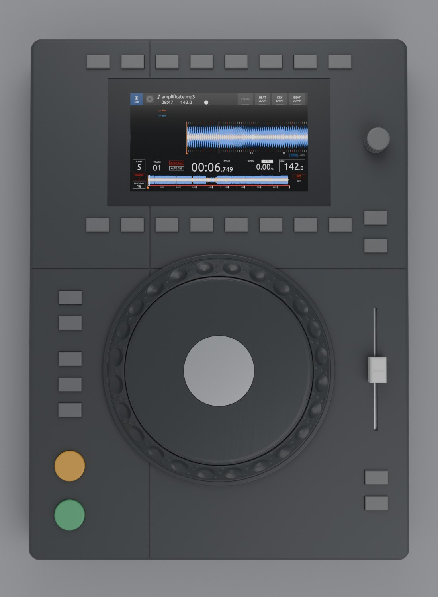
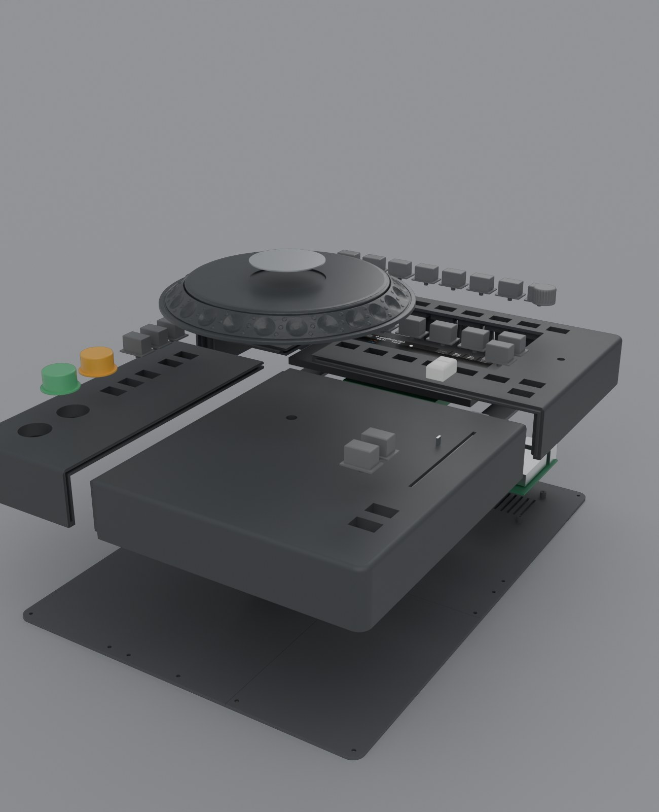
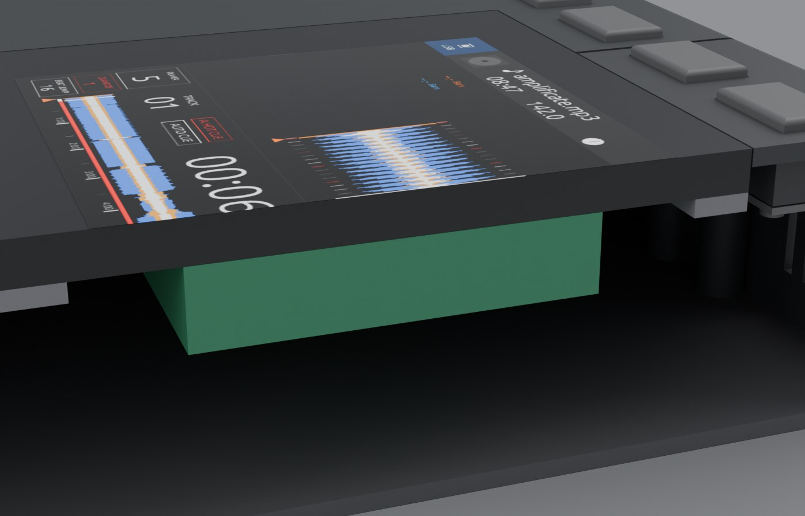

# deck7 — the full-size deck, first iteration

The full-size OpenDeck (ADK-1000): a CDJ-3000-sized body (329 × 453 × 50 mm,
68.7 mm to the top of the jog) around a **200 mm jog**, the official
**Raspberry Pi 7" Touch Display** (800 × 480, the panel the test Pi runs,
`vc4-kms-dsi-7inch`) and a Raspberry Pi 5 with its Active Cooler.  Laid out
as a CDJ-3000:

- eight keys above the screen (SOURCE, BROWSE, TAG LIST, PLAYLIST, SEARCH,
  MENU, BACK, TAG TRACK, as the Pi appliance's top-row layout)
- the browse encoder to the right of the screen
- hot cues A–H between the screen and the jog
- LOOP IN, LOOP OUT, RELOOP / EXIT and TRACK search on the left, over CUE
  and PLAY
- the 100 mm tempo fader on the right, with MASTER and BEAT SYNC over it and
  MASTER TEMPO and TEMPO RANGE under it

It sits beside [deck5](../deck5/README.md) (the 5" deck) and is built the
same way, from the same code where it can be.  Every part fits a **256 × 256
bed** (Bambu X1 / P1 / A1).

| | |
|---|---|
|  |  |
| From above. | Cut through the jog's axis: platter, shaft on two 608s, the tower and the AS5600 under the shaft's magnet; the display, its adapter board and the Pi under it. |
|  |  |
|  |  |
| The four top pieces pulled apart. | The display on its frame. |

## What is shared with deck5, and what is not

`params.py` here is the single source of truth for this deck.  deck5's
`jog.py` (platter, tower, shaft) and `caps.py` (PLAY / CUE caps, key caps,
knobs, the screen frame, the fader bracket) are **used unchanged**: they read
their dimensions with `from params import *`, and run from here that is this
folder's `params.py` (it puts deck5 on the import path after deck7).  So the
200 mm platter is deck5's Pioneer reference shape scaled up (`JOG_D`, with
`JOG_H` = 17.71 mm to match), and a fix to either module reaches both decks.
`render.sh` uses deck5's `render_blender.py` and the screen image in deck5's
`assets/`.

New here: `top_shell.py` and `base.py` (a 2 × 2 split, below), and
`assembly.py` and `make_print.py` (adapted from deck5's for eight shell
pieces and the key list).

## The four-piece top

The top is too big for one seam on a 256 mm bed, so it splits on a 2 × 2
grid: `Y_SEAM` (y = 252) across the depth and `X_SEAM` (x = 104.5) along it.
Both seams run under the platter, so the cross where they meet is hidden,
and they miss every key, boss and the fader:

- X_SEAM falls between hot cues B and C (and the matching keys above the
  screen);
- Y_SEAM runs past the fader bracket's ears and under MASTER.

Each seam has deck5's joint: a 6.5 mm band each side, a tongue in a groove,
and a reveal line outside.  The tongue is on the **back** pieces for
Y_SEAM and on the **right** pieces for X_SEAM.  The tongues stop 5 mm short
of the cross so they never meet, and they are trimmed to where the shell
has material (X_SEAM crosses the screen opening).

The base splits on its own grid (x = 220, y = 205) with half-laps, so its
pieces bridge the top's seams.  Where the two laps cross, front-left keeps
the lower half and back-right the upper.  Base screws sit 10 mm either side
of each top seam on the walls, plus one column at the base laps' cross
(under the platter), so the base alone holds the top together.  Glue
(thin CA in the grooves) is optional; try it dry first.

## Parts

### Print (`print/`, already turned to their print orientation)

| File | Qty | Size (mm) | Notes |
|---|---|---|---|
| `top_fl.stl`, `top_fr.stl`, `top_bl.stl`, `top_br.stl` | 1 each | up to 228.5 × 252 | Top face on the bed, no supports. |
| `base_fl.stl`, `base_fr.stl`, `base_bl.stl`, `base_br.stl` | 1 each | up to 224.8 × 252.8 | Flat; countersinks on the bed side. |
| `jog_platter.stl` | 1 | 200 × 200 × 17.7 | Top face down. |
| `jog_tower.stl` | 1 | | Bearing seat up. |
| `jog_shaft.stl` | 1 | 54.7 long | Optional printed test shaft (deck5's design at this deck's length). |
| `cap_play_cue.stl` | 2 | | One green, one orange. |
| `cap_key.stl` | 25 | 20 × 12 key | |
| `knob_fader.stl`, `knob_encoder.stl` | 1 each | | |
| `screen_frame.stl` | 1 | 224 × 110.8 | The display sits on it. |
| `fader_bracket.stl` | 1 | | |

PLA or PETG, 0.2 mm layers, 4 walls, 15–20 % infill.

### Buy

As deck5's list (same bearings, sensor, fader, encoder, inserts), except:

| Part | Qty | Notes |
|---|---|---|
| Raspberry Pi Touch Display (v1), 7", 800 × 480 | 1 | ⚠ caliper before printing (below) |
| 8 mm rod, 54.7 mm + 2 shaft collars | 1 | |
| 12 mm tact switches | 27 | 25 keys + CUE + PLAY; their boards are not designed yet |
| M3 heat-set inserts (4.6 × 5.7) | 29 | 19 base bosses, 4 screen-frame bosses, 2 fader bosses, 4 tower |
| M3 × 8 countersunk | 23 | base (19) + tower (4) |
| M3 × 10 socket + washer | 6 | screen frame (4) and fader bracket (2) up into their bosses |
| M3 × 6 | 4 | up through the frame into the display's metal frame |

The controls connect to the Pi through an RP2350 USB MIDI board (#77).

## ⚠ Measure before you print

- **The display** (`SCR_OUT`, `SCR_T`, `SCR_HOLES`, `SCR_AA`, `SCR_BACK`):
  numbers from the published drawing (glass 192.96 × 110.76, four M3 at
  126.2 × 65.65).  The glass-top-to-metal-back depth (`SCR_T`, 7.0) is a
  guess and sets the frame's height, so caliper it.  Also check the adapter
  board and standoffs under the metal frame (`SCR_BACK`), and whether the
  active area is centred on the glass.
- **Fader** and **Active Cooler height**: as deck5.

## Build

    make deck7                         # every part: watertight, one body, fits the bed, no clashes,
                                       # nothing breaks through the top; writes print/
    hardware/cad/deck7/render.sh [samples]   # assembly + renders/ (Blender)

## Not done yet

- **Switch boards** under the key rows, CUE / PLAY and the encoder (as deck5).
- **A sloped top.**  The CDJ-3000 rises towards the back and its screen tilts
  towards the DJ; this deck is a flat 50 mm box.
- **Jog touch** and a **jog display** (the CDJ-3000 has one in the platter).
- **Audio out**: a USB interface for now (the UCA202 on the test Pi).
