# jogring — the ring-jog test rig

A test rig for the jog in
[docs/design/jog-ring-rollers.md](../../../docs/design/jog-ring-rollers.md).
It is deck7's 206 mm jog, made as a **ring**, so that a **round
smart-watch display** (1.28" to 2.1") can sit still in the middle while the
ring turns around it.  It stands alone on its own base plate, so it can be
printed and handled before deck7 changes.

| | |
|---|---|
| 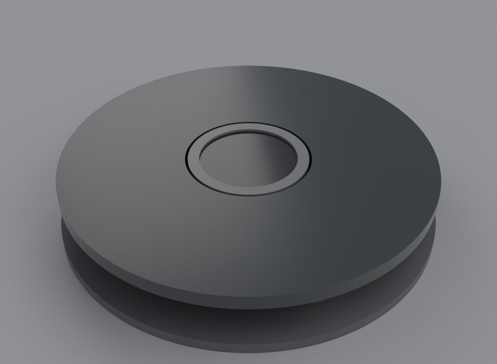 |  |
| 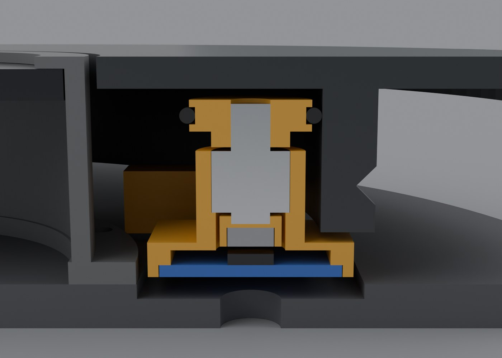 |  |
| The sense roller: an O-ring tyre on the skirt's inside face, two MR105s, the magnet cup over the AS5600. | **vwheel**: a bought V-wheel in the skirt's groove, on the eccentric spacer. |
| 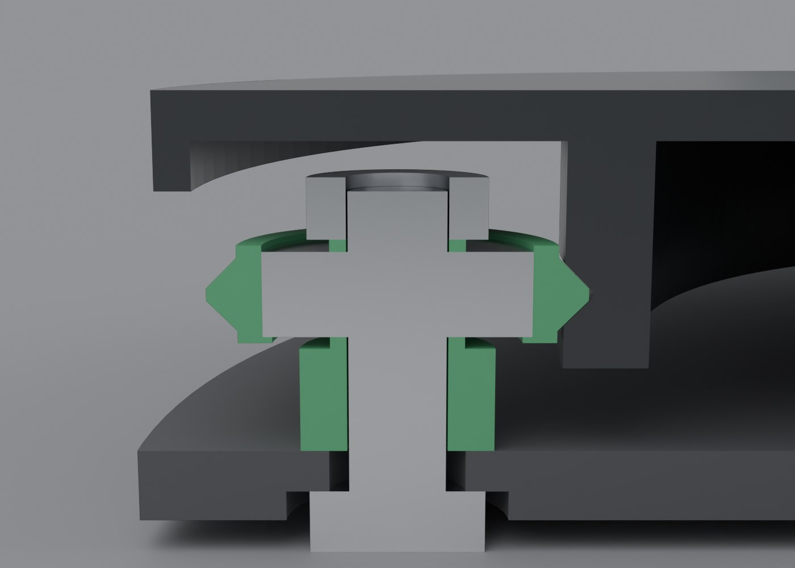 | 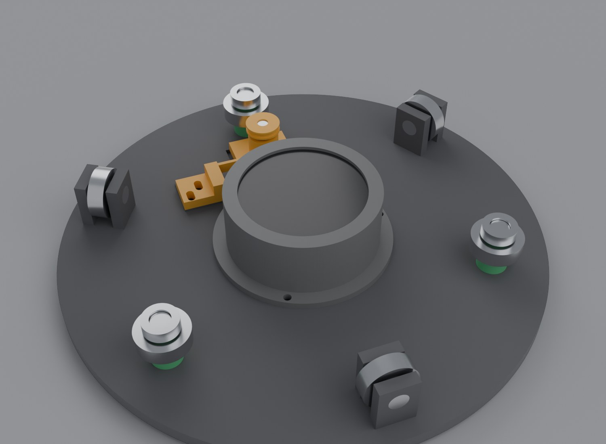 |
| **608**: a skateboard bearing with a printed V tyre, the same V in the same groove; the 270° one slides in a slot to set the preload. | **edge**, ring lifted off: three 608s on edge carry the press, three flat ones centre the ring. |
|  |  |
| **edge**: a support 608 on its 8 mm pin between two cheeks, under the ring's narrow track. | **edge**: a guide 608 on the skirt, with the skirt's lip 0.3 mm under it. |

## Six versions

**mini** (newest, for fast iteration): the pioneer layout at **5"
(127 mm)**, on Dan's little 10 × 6 × 3 bearings, which snap onto bosses.

| | |
|---|---|
| 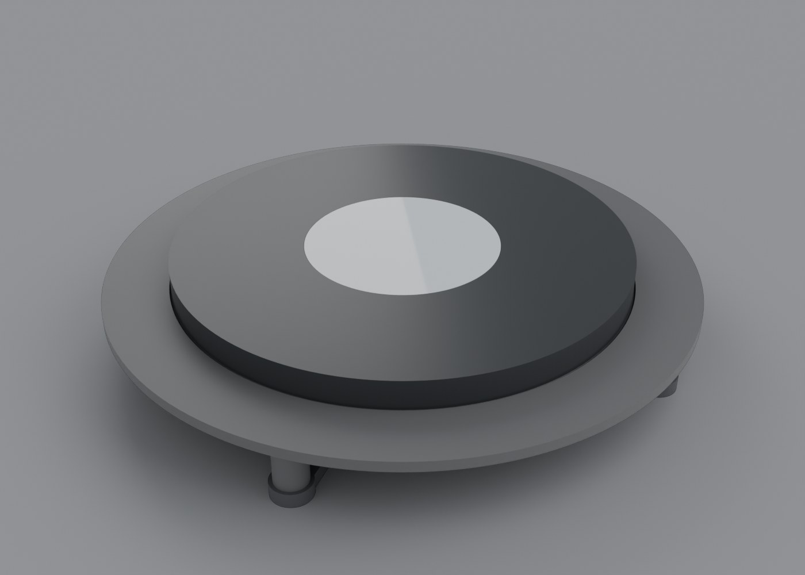 | 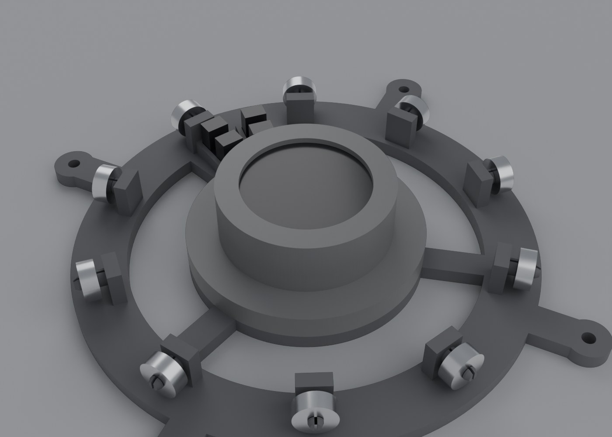 |
| The 5" ring under its deck-top stand-in, with the window over a 1.28" display. | Ring and deck top off: the open carrier, 10 bearings snapped onto split stubs, the two interrupters on their pad. |
| 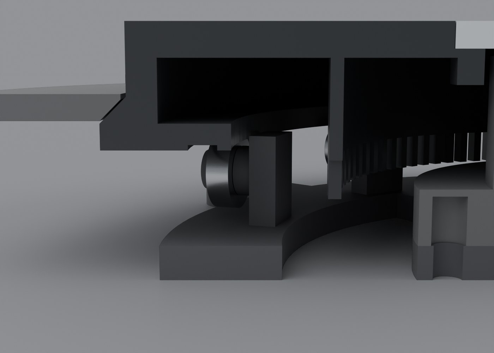 | |
| Section: a bearing on its stub under the ring's groove, and the ridge under the deck top. | |

### The mini version

- **Bearings snap on.** Each of the 10 bearings (at r 55) pushes onto a
  stub that stands out radially from a post printed with the carrier.  A
  vertical slot splits the stub along its length, so it prints without
  support and the halves carry the press in their stiff direction.  A
  0.25 mm barb at the tip clicks past the inner race and holds it, and a
  shoulder touches the inner race only.  The bearings are Dan's
  **10 × 6 × 3 (MR106ZZ)**.  His calipers read the bore 5.8 mm (inside
  jaws read a small bore low), so the stub is sized to 5.8 and the barb
  (Ø6.3) still holds a true 6.0 bore.  The snap bends the halves 2.3 %:
  **print the carrier in PETG** (PLA yields near 2.5 %).  If a bearing is
  loose or won't go on, change `STUB_D` in `mini.py`.
- **Hollow carrier.** The ring below is open in the middle, r 46 to 60.
  Three spokes and the opto pad join it to a small ring under the hub, and
  the display's cable leaves through the middle.
- **Mounts under a deck shell, from underneath.** `mini/retainer` stands
  in for the deck top.  Four posts hang from its underside, with M3 heat-set
  inserts in their feet.  The carrier screws up into them from below, and
  the hub screws up through the carrier into inserts in its flange.  The
  ring's ridge sits 0.3 mm under the deck top, so the shell retains the
  platter.
- **Encoder.** A fin at r 39.5 with **64 slots** (1.94 mm), two sensors
  8¼ slots apart: **256 counts a turn**, in quadrature (`make jogring`
  checks it).  The slots are coarse enough for a premade LM393 slot-sensor
  board's wide beam, and they work just as well with a bare interrupter.
  Each sensor sits on a bracket that screws up from under the carrier with
  two M3 thread-forming screws (holes 16 mm apart, tangential, centred on
  r 39.5), so the sensor can change without reprinting the ring or the
  carrier.  `mini/opto_bracket.stl` (print 2) takes a flangeless **Vishay
  TCST1202** (or TCST1103).  A bracket for the premade boards uses the same
  two holes; it gets drawn once one is calipered.  The beam must sit at
  z 14.3 (the fin's slots run from 12.3 to 16.8 over the base's underside).
- **Window.** A **Ø54 × 3** laser-cut clear disc over the 1.28" GC9A01.
  The jog stands 8 mm proud of the deck top.
- **Display mount.** The module stands on its four M2 standoffs on a floor
  inside `mini/hub_128`: holes on **25 × 19** centres (25 across, 19 up the
  screen, +y), M2 screws up through the floor from below, reached through
  the carrier's open middle.  A Ø22 hole in the floor lets the cable out.
  The module is **11.5 mm** from glass top to standoff feet (`DISP_STACK`,
  calipered), so the floor sits 11.5 under the glass, and the glass sits
  **0.5 mm under the window**, just under the jog's centre.  The hub's wall
  ends flush with the glass (no lip: the screws hold the module), 1.5 mm
  inside the ring's bore.
- **The module's board tab.** The board sticks out ~2 mm past the bezel in
  one place, ~16 wide (44 across the module there), pointing out from a
  25 mm side of the holes.  The hub's wall has an 18 mm notch for it (on
  -y), and the ring's bore lip under the window is moved out to r 26.6 so
  the turning ring clears a tab reaching up to r 24.5.  Turn the module so
  the tab drops into the notch.
- **Hub screws.** 3 × M3 on a **54 mm BCD**, 120° apart, in both the hub and
  the carrier.  The hub's insert holes are **Ø4.4** (4.0 printed too tight),
  and the carrier's clearance holes are Ø3.8, to take a print's error.

## Five full-size versions

**pioneer** (newest): the layout of the Pioneer jog Dan took apart, with
his changes: one circle of rollers, an optical encoder, and a clear window.

| | |
|---|---|
| 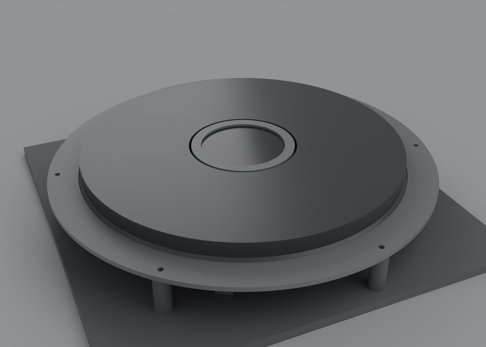 | 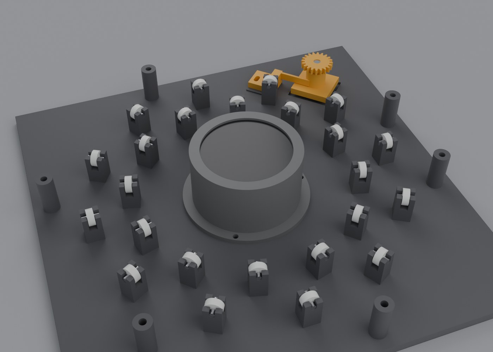 |
| The ring under its "deck top" stand-in, with the clear window over the display. | Ring and deck top off: 16 rollers, the six posts, and the two opto interrupters (at 90° and 110.5°). |
| 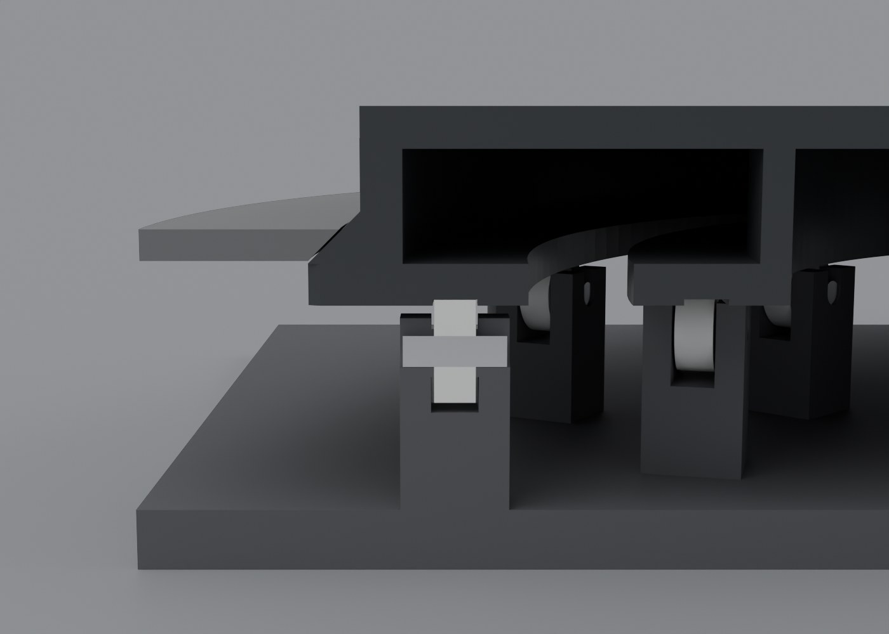 | 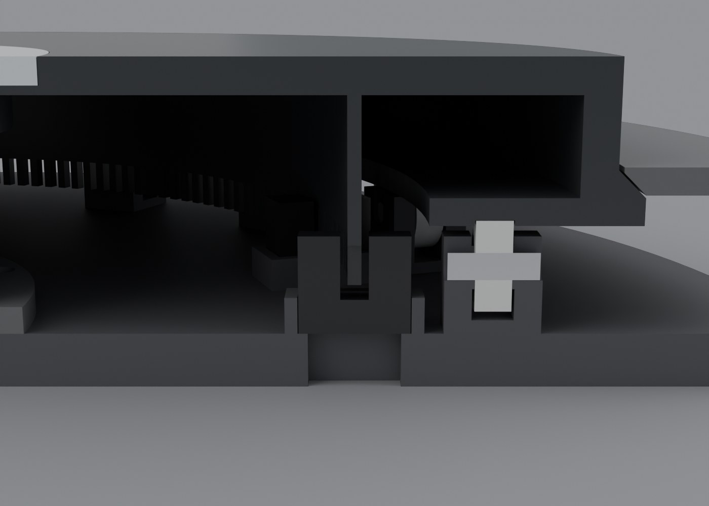 |
| Section: the ring's foot on a roller, in its groove; the ridge under the deck top. | Section: the slotted fin in an interrupter's gap, beside a roller. |

### The pioneer version

From the teardown: the ring rides on small plastic wheels on pins (axles
horizontal, about 10 mm), and a little ridge round its foot sits under the
deck's top, which stops it lifting.  Everything fastens from inside.

- **Rollers.** One circle of 16 at r 90, near the rim, so a lean on the rim
  has little leverage.  They're 10 × 4: **623 bearings** (10 × 3 × 4) or
  printed `pioneer/wheel.stl` (TPU for a quiet roll, PETG for a firm one),
  on **3 mm pins, 10 mm long**.  Each pin drops into a slot open at the top
  of a block printed with the plate: no tools.  Ø5 bosses on the walls bear
  on a 623's inner race only.
- **Centring.** The rollers run in one 0.6 mm groove under the ring (0.15
  side clearance).  A 0.2 mm shift meets the 8 rollers on that side; a press
  loads all 16.
- **Lift.** The ridge sits 0.3 mm under `pioneer/retainer.stl`, which
  stands in for the deck's top on six posts.  In deck7 the top shell is the
  retainer, and the roller carrier screws to it from inside.
- **Encoder.** A 1.5 mm fin hangs from the ring at r 75.  Its foot has 180
  slots (slot = bar = 1.31 mm) and runs through two slotted opto interrupters
  (3.1 mm gap, 0.73 mm clear on each side) standing in pockets on the plate.
  The second sits 10¼ slots on from the first, so the two beams are a
  quarter-slot apart: **quadrature, 720 counts a turn, with direction**.
  `make jogring` proves it on every build by casting each beam across its
  gap while it turns the ring mesh: the states run 00 → 10 → 11 → 01, one
  step at a time.  With the sensors in phase the build fails, which shows
  the check bites.  For more
  counts, a finer laser-cut code ring is the next step (360 slots in 0.5 mm
  black film would give 1440).
- **Window.** A **laser-cut clear disc, Ø84 × 3 mm**, is glued into a
  rebate round the bore, flush with the top.  The hub stays 0.8 mm under it,
  so the display shows through and the top is one continuous surface, which
  is good for touch later.
- **Height.** The deck top is at 24.3 and the jog's top at 35.9: 11.6 proud.
  The plate is Ø250.

## Four other versions

**crossed** (newest, Dan's pick to try): six 608s, all tilted 45°.  Every
bearing both carries load and centres the ring, and nothing slides.

| | |
|---|---|
| 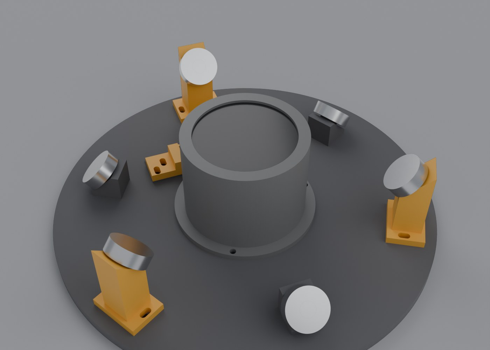 | 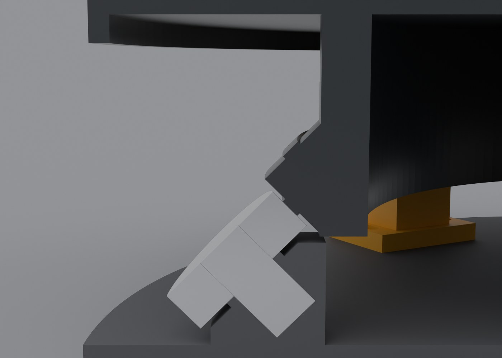 |
| Ring lifted off: three 608s tilted up-and-in on posts printed with the plate (grey), three tilted down-and-in on hold-down posts that slide for the preload (orange). | Section: a lower 608 on its land on the ridge's lower face. |

### The crossed version

- **Ridge.** A diamond ridge (45° faces, 8 mm deep) runs around the skirt,
  with its tip at z 31.  Each face has a 3 mm land, 0.5 mm proud, which is
  all the race touches, so it scrubs about 3 %.
- **Lower row** (30° / 150° / 270°): each 608 is tilted with its axis
  outward-up, and sits under the ridge's lower face.  It carries the press
  and pushes the ring towards the centre.  Its post is printed with the
  plate, with an 8 mm pin, 16 mm long, pressed 8 mm into it.  A Ø11 boss
  bears on the inner race only.
- **Upper row** (90° / 210° / 330°): each 608 is tilted the other way and
  sits over the ridge's upper face.  It holds the ring down, so leaning on
  the rim rolls instead of sliding, and it centres too.  These posts
  (`crossed/holddown.stl`, 3 of them) are separate.  Each stands on two M3s
  in radial slots: push it inward until the play is gone, then tighten.
- **Height.** Two rows of tilted 608s span about 45 mm, so on the rig the
  jog's top is at 58.4 (35.5 on the others).  The hub is taller to match
  (`crossed/hub_*`).  In deck7 the bearings would sit down inside the 50 mm
  body.
- **Retaining.** A 608 is a slip fit on 8 mm rod.  Glue the inner races
  (retaining compound) and the pins.

`make jogring` also nudges each version's ring 0.4 mm along x, y and z,
and tilts it 0.5° about x and y.  Every nudge has to run into a bearing (or,
on the edge version, into the lip), or the build fails.  The sprung roller
doesn't count.

## The other three

| | `print/edge/` | `print/608/` | `print/vwheel/` (when the wheels come) |
|---|---|---|---|
| Idea | as Pioneer and most decks: bearings **on edge** take the press straight down | a 608 dressed as a V-wheel | bought V-wheels |
| Bearings | 6 × 608: 3 on edge under the ring, 3 flat against the skirt | 3 × 608 in printed V tyres | 3 × Solid V wheels |
| Ring | `edge/ring.stl`: a 3 mm track under the top (r 88), a plain skirt, a lip at its foot | `ring.stl` (V groove) | `ring.stl` (V groove) |
| Rolling surface | steel race on the printed track | printed tyre on printed groove | POM on printed groove |
| Tipping | a lean on the rim lifts the far side 0.3 mm onto the lip under the guides (it slides there, only then) | held by the V | held by the V |
| Play | the 330° guide slides in a slot | the 270° wheel slides in a slot | eccentric spacer |
| Feel for eddy drag | r 72–85 under the top is clear | r 74–100 | r 74–100 |

The checks prove each version holds the ring.  For the edge version:

| Ring moved | What stops it |
|---|---|
| pressed down 0.2 mm | the three supports |
| lifted 0.4 mm | the lip catches all three guides |
| tilted 0.5° | a support on one side, the lip under a guide on the other |
| shifted 0.2 mm | a guide |

### The edge version

- **Supports.** Each 608 stands on an 8 mm steel pin, 19 mm long.  The pin
  is pushed in from outside through two cheeks printed as part of the
  plate.  It's a grip fit (`PIN_FIT` 7.95): the same rod as deck7's shaft,
  cut short.  Ø11 bosses on the cheeks bear on the inner race only.  The
  race's top runs 0.05 mm under a 3 mm track on the ring's underside.  The
  narrow track keeps the race's two edges from scrubbing against each other
  (about 2 % instead of 8 %).
- **Guides.** Three 608s lie flat against the skirt's outside, on M8s from
  below: the same stack as the 608 version, with a Ø13 foot so the spacer
  clears the lip.  The 330° one slides in a slot: push it in and tighten.
- **Lip.** A 2 mm lip at the skirt's foot reaches under the guides' outer
  races, 0.3 mm below them.

## The 608 version (V tyres)

These two versions share the ring (and, with the edge version, the hub,
arm and roller).  The groove's shape depends only on the V (its tip,
its 45° flanks, its height and how high it sits), not on the wheel's
diameter.  The 608's printed tyre copies the V-wheel's V, so **the same
`ring.stl` fits both**.  Print the 608 version now; swap the plate when the
V-wheels arrive.

| | `print/608/` (print now) | `print/vwheel/` (when the wheels come) |
|---|---|---|
| Rollers | 3 × 608 (skateboard) bearings, each in a printed V tyre (Ø31) at r 83.5 | 3 × Solid V wheels (Ø23.9) at r 79.95 |
| Preload | the 270° bolt slides ± 1.5 mm in a radial slot: push the wheel in and tighten | eccentric spacer |
| Running surface | printed tyre on printed groove: fine to judge the layout and the roller, noisier and wears faster | POM on printed groove: smoother |
| Bolts | M8 × 25 up from below (heads in counterbores, 2.8 mm proud: use feet ≥ 4 mm), 1 mm printed race spacer, M8 thin nut | M5 × 30 down from the top, nuts trapped in the plate |

The tyre is a press fit on the 608.  **Print `608/tyre_fit.stl` first**:
three short rings, marked with 1, 2 and 3 notches, at bores 21.85 / 21.95 /
22.05.  Press a 608 into each, set `TYRE_BORE` in `params.py` to the snug
one, and run `make jogring`.  Tyres print well in PETG; TPU is worth trying
for a quieter, softer roll.

It is built to answer three questions:

1. **Is it smooth, with no play?**  Three V-wheels run in a V groove
   around the skirt.  Turn the eccentric until the play is gone and the
   ring still spins freely.
2. **Does the roller slip?**  Spin the ring hard and stop it dead, then
   check that it reads the same angle on the way back.
3. **How does it feel?**  The ring is as light as it prints, as on a
   Pioneer.  Under the top, r 74–100 is kept flat and clear for an
   aluminium or copper sheet and fixed magnets, in case eddy-current drag is
   tried.

## How it works

- **Ring.** One print, 206 × 22.5 mm, top face down.  A Ø140 skirt hangs
  under the top, with a 90° V groove around its outside.
- **Wheels** (V-wheel version; the 608 version is above).  Three OpenBuilds-style Solid V wheels (625 bearings) stand
  on M5 bolts at r 79.95, 30° / 150° / 270°.  The two fixed wheels sit on
  6 mm spacers, with their nuts trapped in the plate.  The 270° wheel sits
  on an eccentric spacer, which sets the preload.  The wheels are under the
  platter and can't be seen.
- **Hub.** Fixed, flush with the ring's top, with a 1.5 mm seam.  There are
  two tops on the same column:
  - `hub_210` holds a 2.1" panel under its lip;
  - `hub_128` has a locating ring for the 1.28" GC9A01 module.

  Three M3 screws go through the flange into inserts in the plate.  The
  display's cable runs down the hollow column and out through the plate's
  Ø40 hole.
- **Angle.** An O-ring tyre (Ø18) runs on the skirt's inside face.  The
  roller is on a 5 mm axle in two MR105s.  A magnet cup on the axle's lower
  end turns 1 mm over the AS5600, whose board slides into the arm from
  below.  The roller turns **7 × per platter turn**, about 28,700 counts
  per turn, against 4096 on deck7's shaft.
- **Preload.** The arm is one print: boss, a flexure beam (1.16 N/mm) and a
  slotted foot.  It is drawn with the tyre just touching.  Slide the foot
  outward (0–3 mm, up to about 3.5 N) and tighten its two M3s.

## Parts

### Print (`print/`, already in print orientation)

| File | Qty | Notes |
|---|---|---|
| `ring.stl` | 1 | 206 × 205.9 × 22.5, top face down |
| `608/plate.stl` *or* `vwheel/plate.stl` | 1 | Ø210 |
| **edge:** `edge/ring.stl` + `edge/plate.stl` (with the cheeks, 27.5 tall) | 1 each | instead of the two above |
| **edge:** `edge/spacer.stl`, `edge/race_spacer.stl` | 3 each | |
| **crossed:** `crossed/ring.stl`, `crossed/plate.stl`, `crossed/hub_128.stl` (or `_210`) | 1 each | instead of the ring, plate and hub above |
| **crossed:** `crossed/holddown.stl` | 3 | flat on the bed |
| **pioneer:** `pioneer/ring.stl`, `pioneer/plate.stl` (Ø250), `pioneer/retainer.stl`, `pioneer/hub_128.stl` (or `_210`) | 1 each | its own set: no arm or roller (the encoder is optical) |
| **pioneer:** `pioneer/wheel.stl` | 16 | only if not using 623s |
| **mini:** `mini/ring.stl`, `mini/retainer.stl`, `mini/hub_128.stl` | 1 each | its own set, all on a 165 mm square |
| **mini:** `mini/carrier.stl` | 1 | PETG (the snap stubs) |
| **mini:** `mini/opto_bracket.stl` | 2 | for TCST1202 / TCST1103 sensors |
| `608/tyre_fit.stl` | 1 | print first (above) |
| `608/tyre.stl`, `608/spacer.stl`, `608/race_spacer.stl` | 3 each | the 608 version only |
| `hub_210.stl` / `hub_128.stl` | 1 | one for the display you have |
| `arm.stl` | 1 | flat on its underside; the beam bridges about 20 mm |
| `roller.stl` | 1 | |
| `magnet_cup.stl` | 1 | glue it to the axle's end, magnet in its pocket |

PETG, 0.2 mm layers, 4 walls.

### Buy

| Part | Qty | Notes |
|---|---|---|
| **mini version:** MR106ZZ (10 × 6 × 3) | 10 | snap on: no pins |
| **mini version:** Vishay TCST1202 (or a premade LM393 slot board, with its own bracket) | 2 | |
| **mini version:** M3 × 8 thread-forming | 4 | the opto brackets, up from below |
| **mini version:** M2 × 5 | 4 | the display's standoffs, up through the hub's floor |
| **mini version:** clear acrylic, 3 mm, laser-cut Ø54 | 1 | the window |
| **mini version:** M3 × 8 + inserts | 7 + 7 | hub (3), deck top (4) |
| **pioneer version:** 623ZZ (10 × 3 × 4), or print the wheels | 16 | |
| **pioneer version:** 3 mm steel pin, 10 mm | 16 | |
| **pioneer version:** slotted opto interrupter, 3.1 mm gap, no mounting flange (Vishay TCST1202 or TCST1103, 11.9 × 6.3 × 10.8; not the flanged TCST2xxx, 24.5 long) | 2 | ⚠ caliper the body and beam height (`OPTO`, `OPTO_AXIS`) |
| **pioneer version:** clear acrylic, 3 mm, laser-cut Ø84 | 1 | the window |
| **pioneer version:** M3 × 8 + inserts | 9 + 9 | hub (3), deck top (6) |
| **crossed version:** 608 bearings | 6 | |
| **crossed version:** 8 mm steel rod, 16 mm | 6 | the pins |
| **crossed version:** M3 × 8 + inserts | 6 + 6 | the hold-down posts |
| **edge version:** 608 bearings | 6 | |
| **edge version:** 8 mm steel rod, 19 mm | 3 | the support pins |
| **edge version:** M8 × 25 hex bolt + M8 thin nut | 3 | the guides |
| **608 version:** 608 bearings (skateboard) | 3 | |
| **608 version:** M8 × 25 hex bolt + M8 thin nut (5 mm) | 3 | |
| **V-wheel version, from here to the M5 bolts:** | | |
| Solid V wheel (625 bearings), OD 23.9 × 10.23 | 3 | ⚠ caliper the V (`WHEEL_*`) |
| Aluminium spacer 10 × 6 | 2 | |
| Eccentric spacer, 6.35 mm, 7.2 mm shank | 1 | ⚠ |
| M5 × 30 socket + washer + nut | 3 | |
| MR105ZZ (10 × 5 × 4) | 2 | |
| 5 mm rod, 15.5 mm | 1 | |
| O-ring 14 × 2 (NBR) | 1 | ⚠ the tyre: 14 mm root, Ø18 over it |
| Diametric magnet 6 × 2.5 | 1 | |
| AS5600 board, 23.8 square | 1 | as deck7 |
| M3 grub, thread-forming | 1 | the roller on the axle |
| M3 × 8 + M3 heat-set inserts (4.0 × 5.7) | 5 + 5 | hub (3), arm foot (2) |
| Round display: 1.28" GC9A01 module, or a 2.1" round panel | 1 | ⚠ measure the module (`DISPLAYS`) |

## ⚠ Measure before printing

The V wheel's profile (`WHEEL_OD`, `WHEEL_V_H`, `WHEEL_TIP_W`, 45° flanks),
the eccentric spacer, the O-ring, and both displays' module diameters and
windows.  The groove is drawn from the wheel's numbers, so a different V
changes `ring.stl`.

## Build

    make jogring                         # every part: watertight, one body, fits the bed; both versions'
                                         # assemblies checked for clashes
    hardware/cad/jogring/render.sh [samples]   # renders/ (Blender)

The checks also draw the 1.28" module in `hub_128`.  The two places that
touch on purpose, the wheels' V in the groove and the tyre on the skirt, are
drawn 0.05 mm apart.

## Not decided yet

- **Jog touch.**  A Pioneer jog uses a physical switch.  On a ring, that
  could be a floating top plate pressing a continuous lip onto a fixed
  switch, which works at any angle.  Capacitive coupling across the gap is
  the other route.  The rig's ring is one piece for now.
- **Eddy-current drag**: the clear band under the top is kept for it.
- **The display's driver** (the Pi or the RP2350) and the jog-screen view.
