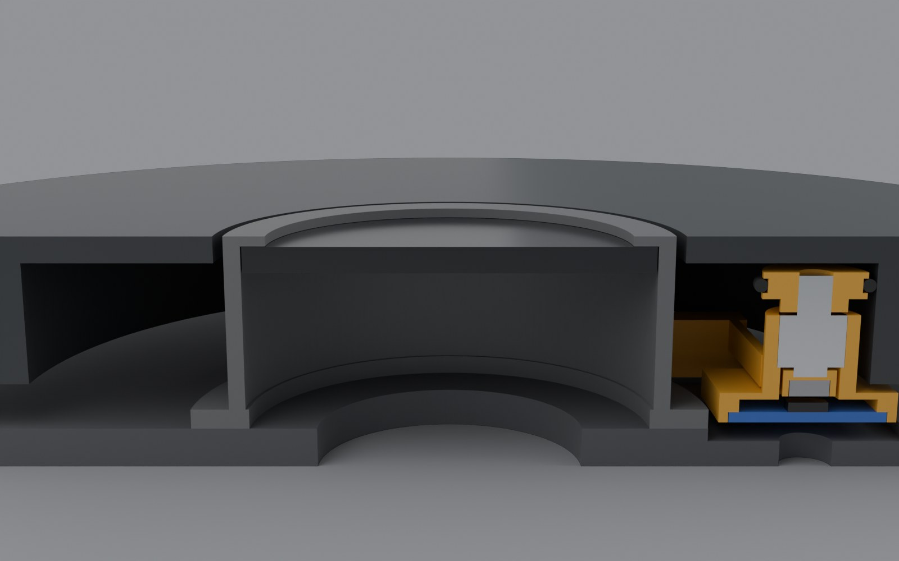
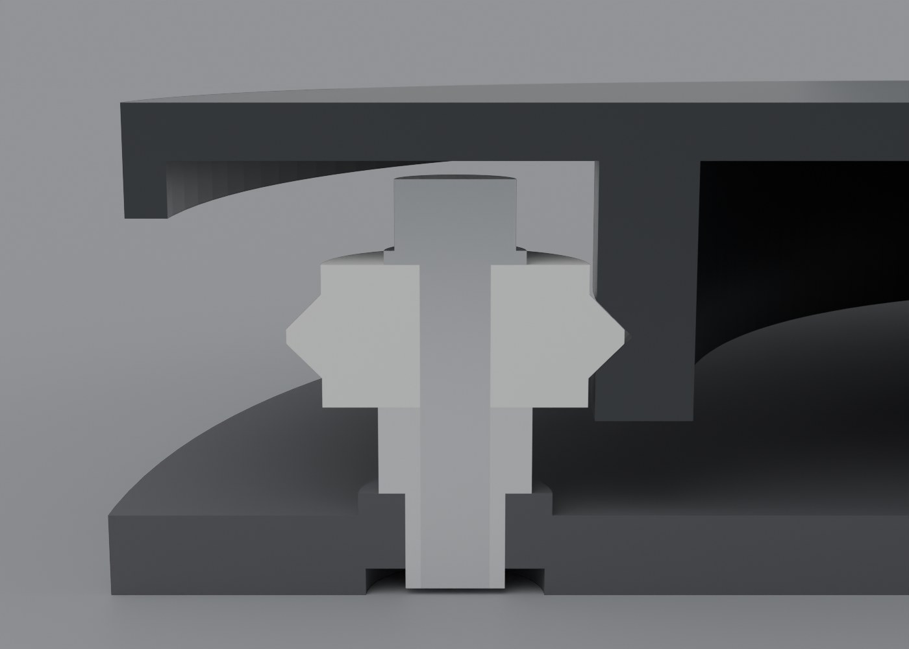
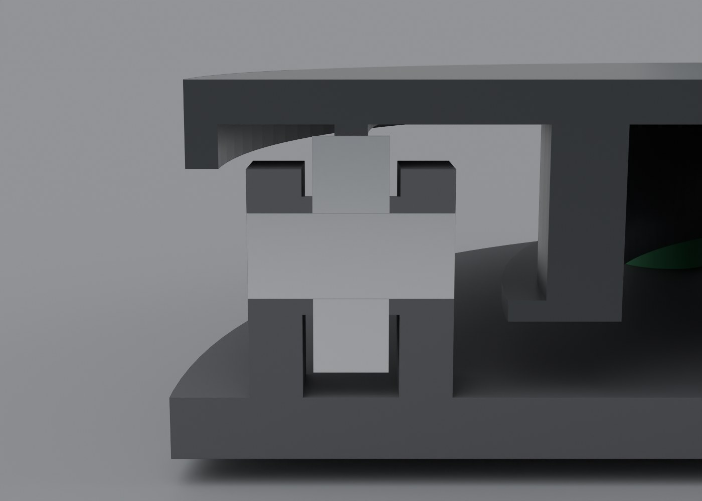
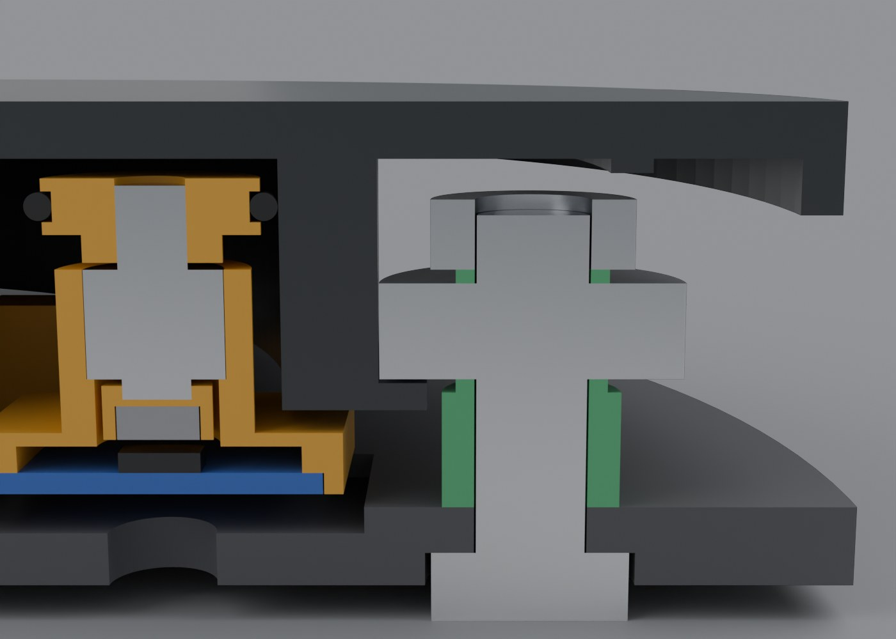

# jogring — the ring-jog test rig

A test rig for the jog in
[docs/design/jog-ring-rollers.md](../../../docs/design/jog-ring-rollers.md).
It is deck7's 206 mm jog, made as a **ring**, so that a **round
smart-watch display** (1.28" to 2.1") can sit still in the middle while the
ring turns around it.  It stands alone on its own base plate, so it can be
printed and handled before deck7 changes.

| | |
|---|---|
|  |  |
|  |  |
| The sense roller: an O-ring tyre on the skirt's inside face, two MR105s, the magnet cup over the AS5600. | **vwheel**: a bought V-wheel in the skirt's groove, on the eccentric spacer. |
|  |  |
| **608**: a skateboard bearing with a printed V tyre, the same V in the same groove; the 270° one slides in a slot to set the preload. | **edge**, ring lifted off: three 608s on edge carry the press, three flat ones centre the ring. |
|  |  |
| **edge**: a support 608 on its 8 mm pin between two cheeks, under the ring's narrow track. | **edge**: a guide 608 on the skirt, with the skirt's lip 0.3 mm under it. |

## Three versions

| | `print/edge/` (print now) | `print/608/` (print now) | `print/vwheel/` (when the wheels come) |
|---|---|---|---|
| Idea | as Pioneer and most decks: bearings **on edge** take the press straight down | a 608 dressed as a V-wheel | bought V-wheels |
| Bearings | 6 × 608: 3 on edge under the ring, 3 flat against the skirt | 3 × 608 in printed V tyres | 3 × Solid V wheels |
| Ring | `edge/ring.stl`: a 3 mm track under the top (r 88), a plain skirt, a lip at its foot | `ring.stl` (V groove) | `ring.stl` (V groove) |
| Rolling surface | steel race on the printed track | printed tyre on printed groove | POM on printed groove |
| Tipping | a lean on the rim lifts the far side 0.3 mm onto the lip under the guides (it slides there, only then) | held by the V | held by the V |
| Play | the 330° guide slides in a slot | the 270° wheel slides in a slot | eccentric spacer |
| Feel for eddy drag | r 72–85 under the top is clear | r 74–100 | r 74–100 |

The checks prove each version holds the ring.  For the edge version:

| Ring moved | What stops it |
|---|---|
| pressed down 0.2 mm | the three supports |
| lifted 0.4 mm | the lip catches all three guides |
| tilted 0.5° | a support on one side, the lip under a guide on the other |
| shifted 0.2 mm | a guide |

### The edge version

- **Supports.** Each 608 stands on an 8 mm steel pin, 19 mm long.  The pin
  is pushed in from outside through two cheeks printed as part of the
  plate.  It's a grip fit (`PIN_FIT` 7.95): the same rod as deck7's shaft,
  cut short.  Ø11 bosses on the cheeks bear on the inner race only.  The
  race's top runs 0.05 mm under a 3 mm track on the ring's underside.  The
  narrow track keeps the race's two edges from scrubbing against each other
  (about 2 % instead of 8 %).
- **Guides.** Three 608s lie flat against the skirt's outside, on M8s from
  below: the same stack as the 608 version, with a Ø13 foot so the spacer
  clears the lip.  The 330° one slides in a slot: push it in and tighten.
- **Lip.** A 2 mm lip at the skirt's foot reaches under the guides' outer
  races, 0.3 mm below them.

## The 608 version (V tyres)

These two versions share the ring (and, with the edge version, the hub,
arm and roller).  The groove's shape depends only on the V (its tip,
its 45° flanks, its height and how high it sits), not on the wheel's
diameter.  The 608's printed tyre copies the V-wheel's V, so **the same
`ring.stl` fits both**.  Print the 608 version now; swap the plate when the
V-wheels arrive.

| | `print/608/` (print now) | `print/vwheel/` (when the wheels come) |
|---|---|---|
| Rollers | 3 × 608 (skateboard) bearings, each in a printed V tyre (Ø31) at r 83.5 | 3 × Solid V wheels (Ø23.9) at r 79.95 |
| Preload | the 270° bolt slides ± 1.5 mm in a radial slot: push the wheel in and tighten | eccentric spacer |
| Running surface | printed tyre on printed groove: fine to judge the layout and the roller, noisier and wears faster | POM on printed groove: smoother |
| Bolts | M8 × 25 up from below (heads in counterbores, 2.8 mm proud: use feet ≥ 4 mm), 1 mm printed race spacer, M8 thin nut | M5 × 30 down from the top, nuts trapped in the plate |

The tyre is a press fit on the 608.  **Print `608/tyre_fit.stl` first**:
three short rings, marked with 1, 2 and 3 notches, at bores 21.85 / 21.95 /
22.05.  Press a 608 into each, set `TYRE_BORE` in `params.py` to the snug
one, and run `make jogring`.  Tyres print well in PETG; TPU is worth trying
for a quieter, softer roll.

It is built to answer three questions:

1. **Is it smooth, with no play?**  Three V-wheels run in a V groove
   around the skirt.  Turn the eccentric until the play is gone and the
   ring still spins freely.
2. **Does the roller slip?**  Spin the ring hard and stop it dead, then
   check that it reads the same angle on the way back.
3. **How does it feel?**  The ring is as light as it prints, as on a
   Pioneer.  Under the top, r 74–100 is kept flat and clear for an
   aluminium or copper sheet and fixed magnets, in case eddy-current drag is
   tried.

## How it works

- **Ring.** One print, 206 × 22.5 mm, top face down.  A Ø140 skirt hangs
  under the top, with a 90° V groove around its outside.
- **Wheels** (V-wheel version; the 608 version is above).  Three OpenBuilds-style Solid V wheels (625 bearings) stand
  on M5 bolts at r 79.95, 30° / 150° / 270°.  The two fixed wheels sit on
  6 mm spacers, with their nuts trapped in the plate.  The 270° wheel sits
  on an eccentric spacer, which sets the preload.  The wheels are under the
  platter and can't be seen.
- **Hub.** Fixed, flush with the ring's top, with a 1.5 mm seam.  There are
  two tops on the same column:
  - `hub_210` holds a 2.1" panel under its lip;
  - `hub_128` has a locating ring for the 1.28" GC9A01 module.

  Three M3 screws go through the flange into inserts in the plate.  The
  display's cable runs down the hollow column and out through the plate's
  Ø40 hole.
- **Angle.** An O-ring tyre (Ø18) runs on the skirt's inside face.  The
  roller is on a 5 mm axle in two MR105s.  A magnet cup on the axle's lower
  end turns 1 mm over the AS5600, whose board slides into the arm from
  below.  The roller turns **7 × per platter turn**, about 28,700 counts
  per turn, against 4096 on deck7's shaft.
- **Preload.** The arm is one print: boss, a flexure beam (1.16 N/mm) and a
  slotted foot.  It is drawn with the tyre just touching.  Slide the foot
  outward (0–3 mm, up to about 3.5 N) and tighten its two M3s.

## Parts

### Print (`print/`, already in print orientation)

| File | Qty | Notes |
|---|---|---|
| `ring.stl` | 1 | 206 × 205.9 × 22.5, top face down |
| `608/plate.stl` *or* `vwheel/plate.stl` | 1 | Ø210 |
| **edge:** `edge/ring.stl` + `edge/plate.stl` (with the cheeks, 27.5 tall) | 1 each | instead of the two above |
| **edge:** `edge/spacer.stl`, `edge/race_spacer.stl` | 3 each | |
| `608/tyre_fit.stl` | 1 | print first (above) |
| `608/tyre.stl`, `608/spacer.stl`, `608/race_spacer.stl` | 3 each | the 608 version only |
| `hub_210.stl` / `hub_128.stl` | 1 | one for the display you have |
| `arm.stl` | 1 | flat on its underside; the beam bridges about 20 mm |
| `roller.stl` | 1 | |
| `magnet_cup.stl` | 1 | glue it to the axle's end, magnet in its pocket |

PETG, 0.2 mm layers, 4 walls.

### Buy

| Part | Qty | Notes |
|---|---|---|
| **edge version:** 608 bearings | 6 | |
| **edge version:** 8 mm steel rod, 19 mm | 3 | the support pins |
| **edge version:** M8 × 25 hex bolt + M8 thin nut | 3 | the guides |
| **608 version:** 608 bearings (skateboard) | 3 | |
| **608 version:** M8 × 25 hex bolt + M8 thin nut (5 mm) | 3 | |
| **V-wheel version, from here to the M5 bolts:** | | |
| Solid V wheel (625 bearings), OD 23.9 × 10.23 | 3 | ⚠ caliper the V (`WHEEL_*`) |
| Aluminium spacer 10 × 6 | 2 | |
| Eccentric spacer, 6.35 mm, 7.2 mm shank | 1 | ⚠ |
| M5 × 30 socket + washer + nut | 3 | |
| MR105ZZ (10 × 5 × 4) | 2 | |
| 5 mm rod, 15.5 mm | 1 | |
| O-ring 14 × 2 (NBR) | 1 | ⚠ the tyre: 14 mm root, Ø18 over it |
| Diametric magnet 6 × 2.5 | 1 | |
| AS5600 board, 23.8 square | 1 | as deck7 |
| M3 grub, thread-forming | 1 | the roller on the axle |
| M3 × 8 + M3 heat-set inserts (4.0 × 5.7) | 5 + 5 | hub (3), arm foot (2) |
| Round display: 1.28" GC9A01 module, or a 2.1" round panel | 1 | ⚠ measure the module (`DISPLAYS`) |

## ⚠ Measure before printing

The V wheel's profile (`WHEEL_OD`, `WHEEL_V_H`, `WHEEL_TIP_W`, 45° flanks),
the eccentric spacer, the O-ring, and both displays' module diameters and
windows.  The groove is drawn from the wheel's numbers, so a different V
changes `ring.stl`.

## Build

    make jogring                         # every part: watertight, one body, fits the bed; both versions'
                                         # assemblies checked for clashes
    hardware/cad/jogring/render.sh [samples]   # renders/ (Blender)

The checks also draw the 1.28" module in `hub_128`.  The two places that
touch on purpose, the wheels' V in the groove and the tyre on the skirt, are
drawn 0.05 mm apart.

## Not decided yet

- **Jog touch.**  A Pioneer jog uses a physical switch.  On a ring, that
  could be a floating top plate pressing a continuous lip onto a fixed
  switch, which works at any angle.  Capacitive coupling across the gap is
  the other route.  The rig's ring is one piece for now.
- **Eddy-current drag**: the clear band under the top is kept for it.
- **The display's driver** (the Pi or the RP2350) and the jog-screen view.
